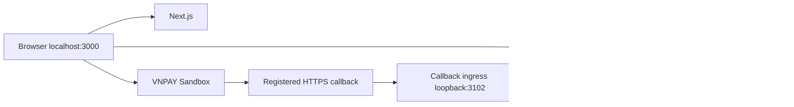

# BrewLite — Kiến trúc hệ thống

**Amendment hiện hành 2026-10-22:** [Checkout/session](CHECKOUT_SESSION_UPDATE.md) bổ sung DB deadline + expiration/verified-receipt workers, Cart tách khỏi settlement và session HttpOnly có rotation/revocation qua Next same-origin proxy. Các mô tả Cart lock/memory-only auth bên dưới cần đọc cùng amendment; QueryDr external vẫn OFF.

## 1. Kiến trúc hiện hành

BrewLite là modular monolith: Next.js App Router gọi REST/JSON NestJS; Prisma dùng PostgreSQL qua adapter-pg. Một repository, hai npm workspaces, một database. Không có queue/cache/microservice hoặc distributed transaction.

Ingress chỉ chuyển tiếp hai callback GET, không công khai API business/Admin/database. Return browser và IPN provider có cùng transport nhưng khác quyền settlement. Xem [boundary ingress](P01D1_LOCAL_CALLBACK_INGRESS.md).

Development dùng Neon hỗ trợ cả MOCK và VNPAY Sandbox. Với Merchant dùng chung, một máy `owner` duy trì callback HTTPS/ingress và nhận IPN cho mọi thành viên; các máy `member` chạy frontend/backend riêng, cùng Neon và cùng verification profile, chỉ kiểm tra endpoint HTTPS chung. Return tới callback owner rồi điều hướng về localhost trên browser của người trả tiền. [Chi tiết Neon](VNPAY_NEON.md).

Normal launcher tách admission khỏi teardown safety: UNKNOWN/receipt/reservation giữ `safeToStop=false` nhưng không tự đóng admission cho Order độc lập. Explicit drain/stop có lý do riêng, giữ đóng qua monitor; `dev:recover` là thao tác operator hủy ý định drain/stop sau readiness checks, không phải financial reconciliation. Backend vẫn áp guards theo Order và owner. [Quy trình phục vụ lại và cập nhật launcher](NORMAL_SANDBOX_MODE.md).

## 2. Module và quyền ghi

| Module | Trách nhiệm |
| --- | --- |
| Auth/Users | bcrypt/JWT, role đọc từ DB, ownership và account lock |
| Catalog | Public menu; Admin product/option lifecycle, inventory adjustments/OCC |
| Cart | Giỏ authenticated PostgreSQL, gộp cấu hình, khóa sửa khi có active unpaid Order |
| Pricing | Giá DB + size/topping, một promotion rồi Loyalty; preview không mutate |
| Orders | Snapshot immutable, stock reservation trực tiếp, state machine và operator actions |
| Payments | MOCK; gateway initiation/status/IPN; explicit zero; guarded reconcile |
| Loyalty | Reserve/settle/release/refund/earn/reverse, append-only attribution và debt |
| Config/Database/Common | Validated environment, Prisma transaction context, envelope và idempotency |

Một application operation sở hữu transaction; service con nhận cùng transaction, không commit riêng. Không có endpoint client tự gán PAID, điểm hay kết quả gateway.

## 3. Frontend và authorization

Next.js dùng Tailwind, Zustand và Fetch API; token JWT giữ memory, không persist vào browser storage. Reload cần login lại; dữ liệu Cart/Order vẫn trong DB. Checkout context/key/payload gắn với user, không resume chéo tài khoản.

CUSTOMER chỉ truy cập tài nguyên của mình. STAFF có queue/read scope được duyệt và workflow pha chế; ADMIN có catalog/inventory/order permissions. Backend kiểm tra JWT, current DB role và ownership; ẩn nút frontend không thay thế authorization. A07 Campaign/Promotion Management đã bị hủy; B13 promotion checkout vẫn còn.

## 4. Transaction, stock và idempotency

1. **Create Order:** owner lock → replay/hash/state/Cart validation → server pricing → product locks theo thứ tự → stock/version CAS và Loyalty reserve → snapshot/claim response, cùng commit.
2. **MOCK:** validate mode/owner/Order/key; success ghi Payment SUCCEEDED + PAID/paidAt + một award/journal + clear purchased Cart cùng transaction. Failure hoàn stock/reservation đúng cycle và giữ Cart.
3. **Gateway initiation:** durable Attempt/reference/signed request + reservation attribution; chưa coi Order là PAID và chưa cấp điểm chỉ vì đã redirect.
4. **Verified IPN:** T1 lưu verification receipt bền vững; T2 apply một lần theo binding/signature/merchant/reference/amount/result và trạng thái hiện hành. Vi phạm invariant giữ REVIEW; ACK không được che settlement chưa an toàn.

Idempotency scope `(user, operation, key)` kèm request hash; cùng key/cùng payload replay response lịch sử, khác payload conflict. Claim và effects nguyên tử. Một success/Order, một award/Order; stock/points không được lặp khi callback replay. Không tự transaction retry; lỗi mạng không chứng minh request đã rollback.

Product stock dùng chung các size, không tồn topping/nguyên liệu. Trừ tại PENDING, failed/cancel unpaid hoàn đúng một lần; retry hợp lệ reacquire từ snapshot, success không trừ tồn lần nữa. Mỗi user tối đa một active unpaid Order, nhiều user/đơn độc lập vẫn được phục vụ. Không TTL/job tự xóa reservation.

## 5. Payment và Loyalty boundaries

- MOCK mặc định, SUCCESS/FAILURE do cấu hình server. VNPAY là optional Sandbox, production bị guard từ chối.
- Tiền Decimal(12,0) VND, API chuỗi số nguyên. Promotion trước, Loyalty 100 VND/point; award `floor(finalAmount/10000)` chỉ tại PAID.
- Zero total dùng explicit INTERNAL_ZERO confirmation, Payment0/Award0/EARN0; không gửi gateway và không tự confirm lúc tạo đơn.
- UNKNOWN/REVIEW giữ reservation/financial guards. Không force trạng thái, tự retry hoặc đổi provider để thoát pending.
- Return GET chỉ verify context rồi 303 tới result local; không ghi receipt/settlement hay gọi QueryDr. Frontend đọc owned authenticated status; verified cancellation mới điều hướng Home.
- Internal paid-cancel hoàn stock/thu hồi đúng award và xử lý redemption/debt nguyên tử; không sửa Payment SUCCEEDED hay thực hiện cash refund.
- External QueryDr transport OFF; không scheduler/batch recovery ngầm.

Chi tiết frozen contract: [P00](P00_VNPAY_SANDBOX_PAYMENT_CONTRACT.md), [L00](L00_LOYALTY_REDEMPTION_CONTRACT.md), [attribution amendment](P01B2A_LOYALTY_ATTRIBUTION_AMENDMENT.md), [IPN T1/T2](P01B2B_VNPAY_IPN_SETTLEMENT_IMPLEMENTATION.md).

## 6. Normal runtime

Launcher tracked trong `scripts/` build source snapshots, quản lý đúng child PIDs và health. MOCK không cần callback. Sandbox chạy DRAIN_ONLY → ingress/ngrok callback-only → smoke → backend-only restart mở admission. Restart backend giữ ingress/ngrok độc lập.

Không có giới hạn 30 phút/một Attempt ở Normal Mode; TTL 900 giây vẫn áp dụng cho từng Attempt. Health failure/drain đóng nhận mới; pending/UNKNOWN/REVIEW/unprocessed receipt ngăn shutdown không an toàn. Controller quản trị local dùng token private, không thêm public management API.

Đây là tiến trình local, không bảo đảm sống qua mất điện/mạng/kill OS. [NORMAL_SANDBOX_MODE](NORMAL_SANDBOX_MODE.md) là hướng dẫn vận hành hiện hành; Gate A/B/C là harness lịch sử. Shared Staging, Compose và production chưa được triển khai.

## 7. Kiểm chứng và tài liệu liên quan

Unit/HTTP fixture tests và PostgreSQL integration kiểm tra graph, authorization, rollback, OCC, duplicate/replay, IPN và Loyalty. Browser matrix/hiệu năng/PAID E2E cần evidence riêng, không suy ra từ thiết kế.

[API](API_DESIGN.md) · [Database](DATABASE_DESIGN.md) · [Decisions](DECISIONS.md) · [Traceability](TRACEABILITY_MATRIX.md) · [Development plan](DEVELOPMENT_PLAN.md).
