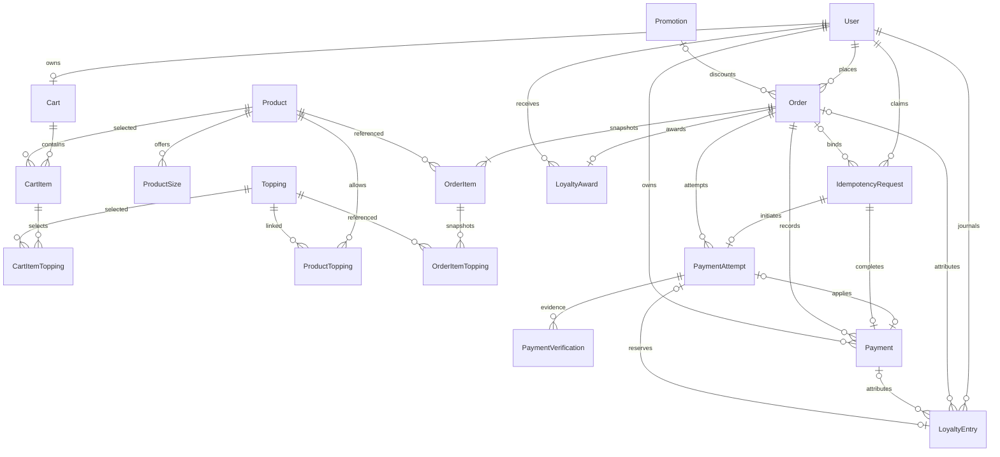

# BrewLite — Thiết kế database

## 1. Nguồn và quy ước

Schema hiện hành: [schema.prisma](../backend/prisma/schema.prisma), [13 migrations](../backend/prisma/migrations), [Prisma config](../backend/prisma.config.ts). Có **18 model nghiệp vụ**, thêm `_prisma_migrations` do Prisma quản lý. Không lấy số bảng ở checkpoint cũ làm schema hiện tại.

PostgreSQL 18.x, snake_case DB/camelCase DTO; UUID PK, tiền `NUMERIC(12,0)` VND (0..999999999999), API money string; thời gian `TIMESTAMPTZ(6)`. Mutable rows có version/timestamps theo model. `qty/stock/version/points` dùng integer với bounds; debt/journal sequence dùng bigint. Giá, tổng và lịch sử Order dùng snapshot, không tính lại từ catalog sau khi đặt.

## 2. Entity và quan hệ

| Model / bảng | Dữ liệu và ràng buộc chính |
| --- | --- |
| User / users | email unique chuẩn hóa, passwordHash, CUSTOMER/STAFF/ADMIN, loyaltyPoints và loyaltyDebt |
| Product / products | name/price/imageUrl, stock/isActive/version; stock dùng chung mọi size |
| ProductSize / product_sizes | PK `(productId,size)`, extraPrice/isActive; S/M/L |
| Topping / toppings | name/price/isActive/version, dùng chung nhiều sản phẩm |
| ProductTopping / product_toppings | PK `(productId,toppingId)`, tập topping được phép của món |
| Cart / carts | userId unique, một giỏ authenticated/user |
| CartItem / cart_items | FK Cart/Product/ProductSize, qty, unique `(cartId,configurationKey)` |
| CartItemTopping / cart_item_toppings | PK `(cartItemId,toppingId)`, lựa chọn topping, không snapshot giá |
| Promotion / promotions | code unique, discountAmount FIXED, minimumSubtotal, startsAt/endsAt/isActive |
| Order / orders | orderCode unique, owner/status/version/paidAt; subtotal/discount/total, promotion snapshot, redeemedPoints/loyaltyDiscount/redemptionState/reservationCycle |
| OrderItem / order_items | FK Order/Product, snapshot tên/size/base/extra/unit/qty/lineTotal |
| OrderItemTopping / order_item_toppings | PK `(orderItemId,toppingId)`, snapshot tên và giá topping |
| IdempotencyRequest / idempotency_requests | unique `(userId,operation,key)`, requestHash, PROCESSING/COMPLETED, order/result/status/timestamps |
| Payment / payments | owner/Order/claim, provider/method/status/amount/failureCode/confirmedAt, gatewayAttemptId nullable unique |
| PaymentAttempt / payment_attempts | Order/claim unique, provider/merchantCode/txnRef unique, amount/currency, gateway/application state, signed parameters, expiry và verified/applied/provider timestamps |
| PaymentVerification / payment_verifications | Attempt/source/state, requestId unique nullable, payload/hash, verifiedAt/processedAt; unique `(attemptId,source,payloadHash)` |
| LoyaltyAward / loyalty_awards | orderId unique, owner/points gốc/reversedAt; không overwrite points khi reverse |
| LoyaltyEntry / loyalty_entries | sequence unique, owner/order/payment/attempt attribution, kind/cycle/points, available/reserved/debt deltas, effectKey; append-only |

ERD thể hiện quan hệ, không thay thế nullable/composite FK/check SQL trong schema/migration.

## 3. Constraint, index và dữ liệu bất biến

- FK lịch sử dùng RESTRICT; CartItem/CartItemTopping theo giỏ dùng CASCADE như schema. Không hard-delete catalog đã được snapshot tham chiếu để né FK.
- Payment unique `(userId,idempotencyKey)` và `idempotencyRequestId`; **partial unique `order_id WHERE status='SUCCEEDED'` nằm trong SQL migration**, không thể hiện đầy đủ bằng Prisma DSL. Failed Payments có thể nhiều theo retry contract.
- Attempt unique claim/ref; unique `(merchantCode,transactionNo)` khi có transactionNo; reference chỉ gắn một intended Attempt, amount/currency/profile không rebind từ callback.
- Verification deduplicate theo Attempt/source/payloadHash. VERIFIED receipt và processedAt phân biệt chứng cứ đã xác minh với local effects đã apply.
- LoyaltyEntry unique `(effectKey,kind)` và `(orderId,kind,cycle)`; paymentAttemptId unique nullable dùng attribution RESERVE. Không backfill/đổi attribution sau khi gửi gateway.
- SQL CHECK kiểm tra money/qty/stock/points/version bounds, snapshot arithmetic, state/timestamps và compatibility provider/method/gateway/zero. Xem migration thay vì chỉ chạy `db push` làm mất constraints.
- Order history index `(userId,createdAt DESC,id DESC)`, Attempt `(orderId,createdAt DESC,id DESC)`; journal `(userId,sequence DESC)`; FK lookup indexes giữ theo schema.
- Các bất biến liên bảng (owner, hash, reservation proof, amount/claim/Payment/Attempt binding) còn được transaction/service kiểm tra, không tuyên bố FK tự bảo đảm toàn bộ.

## 4. Giá và financial invariants

`unitPrice = Product.price + ProductSize.extraPrice + sum(Topping.price)`; `lineTotal = unitPrice × qty`; subtotal tổng các dòng. Một promotion FIXED trước, actual discount bị chặn tại subtotal; Loyalty 100 VND/point sau promotion; `total = subtotal - discountAmount - loyaltyDiscountAmount` không âm. Backend authoritative, không nhận giá/điểm award từ client.

1. Một active unpaid Order/user (`PENDING/PAYMENT_FAILED`), được enforce bằng owner lock; không có partial unique DB tự suy diễn thêm cho rule này.
2. Tạo PENDING giữ stock trực tiếp và reserve points; Cart giữ nguyên/khóa sửa. Tổng qty cùng Product được aggregate/sort trước lock/CAS.
3. Failed/cancel unpaid release đúng cycle, không award và giữ Cart. Retry được phép reacquire từ snapshot, không reprice; success từ reservation hiện hữu không deduct stock lần hai.
4. Success nguyên tử: Payment SUCCEEDED, Order PAID/paidAt/version, redemption SETTLE, một LoyaltyAward + EARN, balance/debt adjustment, clear purchased Cart và claim/result. `floor(total/10000)` chỉ cấp tại PAID, kể cả award0.
5. Paid-cancel nội bộ nguyên tử status + stock + award reversal + redemption REFUND/debt; Payment SUCCEEDED/paidAt/snapshot không bị sửa thành failed hay cash-refunded. Không negative balance để che debt.
6. Gateway chỉ settle từ verified persisted evidence và binding hợp lệ. T1 receipt durable, T2 effects atomic; Return read-only. UNKNOWN/REVIEW/unprocessed receipts giữ guards/reservations, không tự xóa hay force trạng thái.
7. Zero-total confirmation ghi INTERNAL_ZERO/ZERO_TOTAL Payment0, Award0/EARN0; không gateway Attempt và không auto-confirm tại create.

## 5. Journal và reconciliation

`OPENING/RESERVE/SETTLE/RELEASE/EARN/REFUND/REVERSE` là journal append-only theo [L00](L00_LOYALTY_REDEMPTION_CONTRACT.md); available balance, reserved và debt phải đối chiếu theo deltas/cycle/attribution, không chỉ cộng các award chưa reverse. [Amendment](P01B2A_LOYALTY_ATTRIBUTION_AMENDMENT.md) bổ sung linkage RESERVE→Attempt, không đổi business formulas.

Read-only CLI [reconcile-loyalty.cjs](../backend/scripts/reconcile-loyalty.cjs) báo lệch, không repair. Không sửa/xóa history để làm reconciliation pass. Failure trong transaction rollback mọi effects; conflict không tự loop retry.

## 6. Migration và phạm vi

13 migration directories chứa lịch sử initial foundation, Cart, role/catalog lifecycle/inventory, Loyalty, A07 rồi forward compensation và VNPAY/attribution. Giữ **toàn bộ migration chain** dù A07 đã bị hủy; schema hiện tại không có Campaign. Không xóa migration cũ để làm repository gọn.

[README](../README.md) hướng dẫn generate/apply/seed cho DB mới; launcher không migrate/seed/reset. Integration tests dùng schema riêng trên DB local development/test. Chi tiết policy và transaction: [API](API_DESIGN.md), [P00](P00_VNPAY_SANDBOX_PAYMENT_CONTRACT.md), [IPN](P01B2B_VNPAY_IPN_SETTLEMENT_IMPLEMENTATION.md), [L01](L01_LOYALTY_REDEMPTION_IMPLEMENTATION.md).
