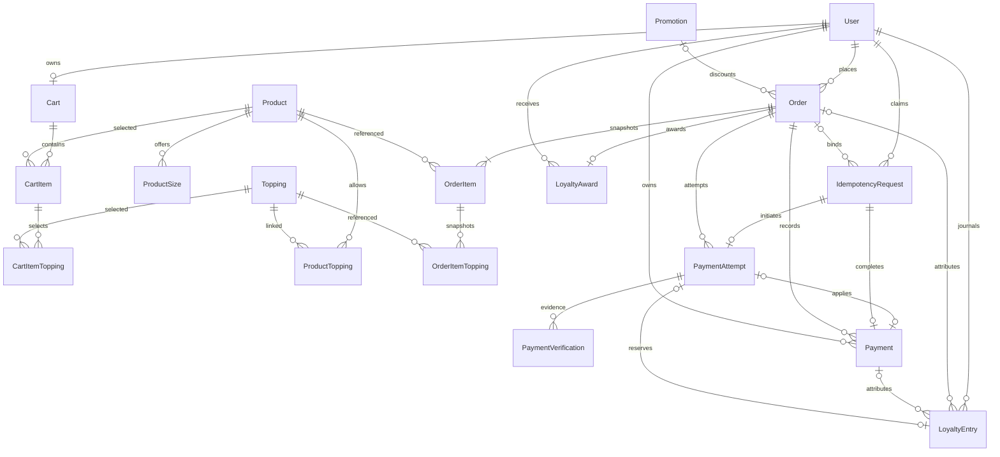

# BrewLite — Thiết kế database

O01, 2026-11-15: [contract](O01_CANCEL_TRACKING.md) bổ sung Order 1:N OrderTrackingEvent, Order 1:N OrderSupportRequest và Order 0:1 OrderRefund; Payment 0:1 OrderRefund. FK User cho actor/requester/reviewer/approver/processor, Restrict. Event sequence BIGSERIAL unique, index(order_id,sequence), append-only; trigger Order INSERT/status change ghi trong cùng transaction, không backfill. Support unique(order_id,requested_by_id,request_key), reason/note tối đa500, OPEN/APPROVED/REJECTED, version. Refund unique order/payment/transaction_reference, amount NUMERIC(12,0)>0, PENDING/SUCCEEDED/FAILED; CHECK approval/processor/time/evidence; SUCCESS và binding bất biến. Schema chuẩn UUID, migration chỉ FK mới tương thích kiểu TEXT thực tế. Không sửa bảng/tồn/số tiền cũ.

I08,2026-11-13: [migration additive](../backend/prisma/migrations/20261113140000_inventory_control/migration.sql) thêm Ingredient variance_percent_threshold NUMERIC(7,3), variance_absolute_threshold NUMERIC(12,3), nullable/không gán mặc định nghiệp vụ, CHECK percent0–1000/absolute≥0. IngredientMovement thêm sequence BIGSERIAL unique và index(ingredient_id,sequence), giữ append-only. IngredientCount thêm DRAFT enum, submitted_at/period_start nullable, recount_requested=false; CHECK state cho phép version tăng lúc gửi nháp, chỉ phiếu xử lý mới có reviewer/time/note. RECOUNT_REQUIRED cũ giữ nguyên; recount mới REJECTED+cờ. CountLine thêm movement_sequence BIGINT nullable≥0, theoretical_consumption NUMERIC(20,3)≥0 và hai ngưỡng snapshot nullable; giữ Count1:N CountLine và Ingredient1:N CountLine/FK. Không đổi kiểu ID hoặc thêm quan hệ. Không thêm cột trung bình/dự phòng/mang đi; nước cũ giữ dữ liệu nhưng không thuộc danh mục18 mục đang quản lý.

Snapshot mới chụp mốc sequence dưới row lock; approve kiểm tra chuỗi before/after/delta và không có COUNT khác, rồi cộng discrepancy trên quantity hiện tại, giữ reserved≤quantity. Sequence backfill chỉ bổ sung identity, không suy thứ tự thời gian lịch sử. Prisma map index về đúng tên `ingredient_movements_ingredient_sequence_idx` trong migration đã áp dụng. CountLine cũ mốc null vẫn dùng version guard. [Contract và kiểm chứng](I08_INVENTORY_CONTROL.md).

I07 được người dùng chốt2026-11-12, triển khai tiếp2026-11-13: thêm bảng `order_recipe_ingredients` (Order×Ingredient unique, snapshot tên/đơn vị/định lượng tổng, state RESERVED/RELEASED/CONSUMED, cycle), FK Restrict/Cascade đến Order và Ingredient. `Ingredient.quantity` là tồn vật lý; `reservedQuantity` là lượng đã giữ; khả dụng=quantity−reservedQuantity, CHECK0≤reserved≤quantity. Dùng lại reserved_quantity trên development mà không đổi giá trị; thêm mặc định0 nếu schema chuẩn chưa có. Thêm nguồn reservation/action/cycle vào IngredientMovement, mở rộng CHECK nhưng giữ nguồn cũ và unique event để chống lặp; nhật ký vẫn append-only. Không sửa bảng ingredient_reservations của extension development cũ. Migration additive giữ fingerprint33 bảng, không chuyển tồn hoặc sửa đơn cũ; FK mới theo kiểu UUID/TEXT thực tế. Danh mục mới tạo19 identity tách biệt, tồn0. [Contract I07](I07_SIZE_RECIPE_CONSUMPTION.md).

Inventory repair2026-11-12: `IngredientService` so sánh ID/FK qua `::text` để chạy được trên cả schema UUID chuẩn và TEXT development, giữ khóa/CAS/FK/CHECK và không đổi schema. Admin initializer hiện có bổ sung14 mục thiếu với tồn0; không sửa tồn có sẵn hoặc chứng từ. [Bằng chứng bảo toàn và kiểm thử cả hai kiểu cột](LOCAL_INVENTORY_REPAIR.md).

Audit2026-11-12 thấy shared development có ID TEXT/số khác schema UUID bên dưới; đợt sửa không thay kiểu cột hoặc migration ledger. Khóa phiên so sánh `id::text`; auth/GET Order đọc tương thích ID số cũ. Hai Product/hai Topping chuẩn hóa UUID qua ON UPDATE CASCADE sau kiểm tra FK; giữ snapshot nghiệp vụ. Thêm hai operator/năm món theo user, không reset/seed Neon hoặc sửa financial state. [Bảo toàn và giới hạn](LOCAL_AUTH_CATALOG_REPAIR.md).

I06: [migration ngưỡng](../backend/prisma/migrations/20261107120000_ingredient_warning_thresholds/migration.sql) chỉ cập nhật ingredients.low_stock_threshold cho9 tên/đơn vị hiện có; CHECK ingredients_unit_threshold_check chuyển sang theo từng mặt hàng, fallback unit cũ. Các CHECK countable/bounds và bảng/FK/quan hệ giữ nguyên. Không đổi name/unit/quantity/version/timestamp/hash/audit. [Bảng và bảo toàn dữ liệu](I06_INGREDIENT_WARNING_THRESHOLDS.md).

I05 amendment2026-11-07: [migration](../backend/prisma/migrations/20261107110000_product_ingredient_availability/migration.sql) thêm OrderItem.ingredientKeysSnapshot / order_items.ingredient_keys_snapshot TEXT[] NOT NULL DEFAULT ARRAY[]::TEXT[]. Mảng rỗng nghĩa item đã dùng Product.stock; keys không rỗng nghĩa đơn mới kiểm tra nguyên liệu, không reserve/restore số ly. Giữ bảng/FK/quan hệ và mọi field cũ; không seed, đổi quantity hoặc phân loại lại snapshot cũ. [Contract/invariants](I05_PRODUCT_INGREDIENT_AVAILABILITY.md).

I04 BAG amendment2026-11-07: [migration BAG](../backend/prisma/migrations/20261107100000_inventory_bag_unit/migration.sql) thêm enum IngredientUnit.BAG, CHECK ingredients_countable_units buộc bao nguyên, ingredients_unit_threshold_check buộc BAG5. Giữ FK/quan hệ và dữ liệu, không sửa migration BOTTLE cũ. [Contract](I04_INVENTORY_CATALOG_REFRESH.md).

I04 amendment 2026-11-07: IngredientUnit thêm BOTTLE (chai), thuộc nguyên liệu; CHECK ingredients_countable_units bắt buộc lượng/ngưỡng chai nguyên và ingredients_unit_threshold_check cố định BOTTLE10. [Migration](../backend/prisma/migrations/20261107090000_inventory_bottle_unit/migration.sql) không đổi dữ liệu, bảng hoặc FK/quan hệ. Danh mục hiện hành14 mục thay danh sách cũ, tạo thiếu tồn0 qua Admin initializer. [Contract](I04_INVENTORY_CATALOG_REFRESH.md).

I03: enum IngredientUnit bổ sung EGG (quả), thuộc nguyên liệu. `ingredients_countable_units` CHECK quantity/threshold nguyên với PIECE/EGG; sửa CHECK ngưỡng thêm EGG10 qua [migration](../backend/prisma/migrations/20261029170000_inventory_egg_unit/migration.sql). Không đổi FK/quan hệ hoặc dòng dữ liệu cũ. Danh mục12 mặt hàng dùng bảng ingredients hiện có với normalizedName unique và quantity0 khi mới tạo; khởi tạo bằng Admin API, không seed quantity hoặc tài khoản. [Contract](I03_RECEIVING_CATALOG.md).

## I02 — Nhóm kho và ngưỡng cố định2026-10-29

[Migration I02](../backend/prisma/migrations/20261029150000_inventory_categories/migration.sql) dùng sáu bảng I01 hiện có; nhóm vật dụng suy từ unit=PIECE, nguyên liệu từ đơn vị đo. Không thêm bảng hoặc cột category trùng thông tin unit. Chuẩn hóa low_stock_threshold PIECE10/L5/KG10, G10000/ML5000 cho dữ liệu cũ; CHECK `ingredients_unit_threshold_check` buộc ngưỡng đúng đơn vị. Không đổi quantity, version, timestamps, requestHash, phiếu hoặc movement. Ngưỡng cảnh báo strict `<` do service và summary thống nhất; bằng ngưỡng còn hàng. Thay quy tắc Admin tự chọn ngưỡng I01 bên dưới. [Contract](I02_INVENTORY_CATEGORIES.md).

## I01 — Nguyên liệu, extension người dùng2026-10-29

Thêm6 model độc lập: Ingredient, IngredientReceipt, IngredientReceiptLine, IngredientCount, IngredientCountLine, IngredientMovement; chỉ thêm inverse relations trên User. Không tái sử dụng Product.stock vì Product là số lượng món, nguyên liệu có đơn vị và số thập phân. [Contract](I01_INGREDIENT_INVENTORY_CONTRACT.md) và [migration](../backend/prisma/migrations/20261029100000_ingredient_inventory/migration.sql).

Rollout2026-10-29: migration I01 đã áp dụng trên Neon shared development; sáu bảng mới có mặt, chưa thêm dữ liệu nghiệp vụ mẫu. Kiểm tra transaction giữ nguyên fingerprint19 bảng nghiệp vụ cũ. Nếu Prisma native engine bị chặn trên Windows, `npm run db:check:ingredients --workspace backend` kiểm tra read-only; `npm run db:migrate:ingredients --workspace backend` là fallback hẹp chỉ áp dụng migration này, kiểm tra chain/checksum/partial schema, lock và rollback nguyên tử. Không reset/seed hoặc thay migration cũ. [Báo cáo](I01_INGREDIENT_INVENTORY_IMPLEMENTATION.md).

Ingredient1:N receipt/count lines và movements; Receipt/Count1:N lines; mỗi line có tối đa một movement (unique FK receiptLineId/countLineId, đúng một source không NULL). Mọi actor FK→User RESTRICT; Count.recountOfId unique self-FK RESTRICT, giữ chuỗi kiểm kê lại. Tạo resource unique(actor,requestKey)+SHA256 hash, tách namespace từng model khỏi idempotency tài chính.

quantity/threshold/snapshot Decimal(12,3), không âm; movement.delta Decimal(13,3), CHECK delta=after-before. PIECE bắt buộc nguyên; ngưỡng do Admin chọn. CHECK lifecycle buộc DRAFT/SUBMITTED version0 chưa có reviewer/time; terminal version1 có actor/time; reject/recount phải có lý do. Movements append-only bằng trigger chặn UPDATE/DELETE. Không DELETE API hoặc cascade mất audit. Không tự trừ nguyên liệu khi bán món.

Transaction actor lock → document lock → ingredients ID tăng dần; cập nhật tồn bulk CAS version, thêm movement và chốt trạng thái trong cùng transaction. Receipt cộng lượng nhận vào tồn hiện tại; count approval chỉ dùng snapshot nếu tất cả version còn khớp, nếu không409 và rollback toàn phiếu. Một count thay thế/phiếu yêu cầu kiểm kê lại, bản cũ giữ nguyên. Reads phân trang cursor UUID50 tài liệu/lượt, order createdAt/id DESC. Chính sách transaction theo PrismaService hiện có; kiểm thử chức năng local dùng budget5s, không suy ra NFR01.

## Additive amendment 2026-10-22 — checkout/session

Migration `20261022160000_checkout_expiration_sessions` thêm nullable `orders.payment_started_at/payment_expires_at/payment_expired_at` (timestamptz6), `cancellation_reason` varchar64; CHECK cặp started/expires cùng NULL hoặc expires=started+10 phút; partial index deadline cho unpaid orders. Không backfill lịch sử. `auth_sessions` chứa UUID PK, user_id FK→users RESTRICT (User1:N sessions), SHA256 token_hash/previous_token_hash, expires_at/revoked_at/created_at và index user_id. Rotation dùng row lock; token plaintext chỉ ở HttpOnly cookie. [Nghiệp vụ, quan hệ và rollout](CHECKOUT_SESSION_UPDATE.md).

## 1. Nguồn và quy ước

Development có thể dùng Neon shared `brewlite_dev`: pooled `DATABASE_URL` cho PrismaPg, direct `DIRECT_URL` cho Prisma CLI. Schema/constraints/migrations không đổi. Với transaction Order/payment trên Neon, tổng deadline 5000 ms và maxWait 2000 ms để chịu remote I/O; SQL lock/statement limits giữ nguyên. Database local giữ baseline 50/400 ms. [Quyết định kỹ thuật và an toàn](VNPAY_NEON.md).

Schema hiện hành: [schema.prisma](../backend/prisma/schema.prisma), [13 migrations](../backend/prisma/migrations), [Prisma config](../backend/prisma.config.ts). Có **18 model nghiệp vụ**, thêm `_prisma_migrations` do Prisma quản lý. Không lấy số bảng ở checkpoint cũ làm schema hiện tại.

PostgreSQL 18.x, snake_case DB/camelCase DTO; UUID PK, tiền `NUMERIC(12,0)` VND (0..999999999999), API money string; thời gian `TIMESTAMPTZ(6)`. Mutable rows có version/timestamps theo model. `qty/stock/version/points` dùng integer với bounds; debt/journal sequence dùng bigint. Giá, tổng và lịch sử Order dùng snapshot, không tính lại từ catalog sau khi đặt.

## 2. Entity và quan hệ

| Model / bảng | Dữ liệu và ràng buộc chính |
| --- | --- |
| User / users | email unique chuẩn hóa, passwordHash, CUSTOMER/STAFF/ADMIN, loyaltyPoints và loyaltyDebt |
| Product / products | name/price/imageUrl, stock/isActive/version; stock dùng chung mọi size |
| ProductSize / product_sizes | PK `(productId,size)`, extraPrice/isActive; S/M/L |
| Topping / toppings | name/price/isActive/version, dùng chung nhiều sản phẩm |
| ProductTopping / product_toppings | PK `(productId,toppingId)`, tập topping được phép của món |
| Cart / carts | userId unique, một giỏ authenticated/user |
| CartItem / cart_items | FK Cart/Product/ProductSize, qty, unique `(cartId,configurationKey)` |
| CartItemTopping / cart_item_toppings | PK `(cartItemId,toppingId)`, lựa chọn topping, không snapshot giá |
| Promotion / promotions | code unique, discountAmount FIXED, minimumSubtotal, startsAt/endsAt/isActive |
| Order / orders | orderCode unique, owner/status/version/paidAt; subtotal/discount/total, promotion snapshot, redeemedPoints/loyaltyDiscount/redemptionState/reservationCycle |
| OrderItem / order_items | FK Order/Product, snapshot tên/size/base/extra/unit/qty/lineTotal |
| OrderItemTopping / order_item_toppings | PK `(orderItemId,toppingId)`, snapshot tên và giá topping |
| IdempotencyRequest / idempotency_requests | unique `(userId,operation,key)`, requestHash, PROCESSING/COMPLETED, order/result/status/timestamps |
| Payment / payments | owner/Order/claim, provider (`VNPAY_SANDBOX` default, `INTERNAL_ZERO`; `MOCK` chỉ giữ cho dòng lịch sử), method (`VNPAY` default, `ZERO_TOTAL`; `WALLET`/`CARD` chỉ giữ cho dòng lịch sử), status/amount/failureCode/confirmedAt, gatewayAttemptId nullable unique |
| PaymentAttempt / payment_attempts | Order/claim unique, provider/merchantCode/txnRef unique, amount/currency, gateway/application state, signed parameters, expiry và verified/applied/provider timestamps |
| PaymentVerification / payment_verifications | Attempt/source/state, requestId unique nullable, payload/hash, verifiedAt/processedAt; unique `(attemptId,source,payloadHash)` |
| LoyaltyAward / loyalty_awards | orderId unique, owner/points gốc/reversedAt; không overwrite points khi reverse |
| LoyaltyEntry / loyalty_entries | sequence unique, owner/order/payment/attempt attribution, kind/cycle/points, available/reserved/debt deltas, effectKey; append-only |

ERD thể hiện quan hệ, không thay thế nullable/composite FK/check SQL trong schema/migration.

## 3. Constraint, index và dữ liệu bất biến

- FK lịch sử dùng RESTRICT; CartItem/CartItemTopping theo giỏ dùng CASCADE như schema. Không hard-delete catalog đã được snapshot tham chiếu để né FK.
- Payment unique `(userId,idempotencyKey)` và `idempotencyRequestId`; **partial unique `order_id WHERE status='SUCCEEDED'` nằm trong SQL migration**, không thể hiện đầy đủ bằng Prisma DSL. Failed Payments có thể nhiều theo retry contract.
- Attempt unique claim/ref; unique `(merchantCode,transactionNo)` khi có transactionNo; reference chỉ gắn một intended Attempt, amount/currency/profile không rebind từ callback.
- Verification deduplicate theo Attempt/source/payloadHash. VERIFIED receipt và processedAt phân biệt chứng cứ đã xác minh với local effects đã apply.
- LoyaltyEntry unique `(effectKey,kind)` và `(orderId,kind,cycle)`; paymentAttemptId unique nullable dùng attribution RESERVE. Không backfill/đổi attribution sau khi gửi gateway.
- SQL CHECK kiểm tra money/qty/stock/points/version bounds, snapshot arithmetic, state/timestamps và compatibility provider/method/gateway/zero. Xem migration thay vì chỉ chạy `db push` làm mất constraints.
- Order history index `(userId,createdAt DESC,id DESC)`, Attempt `(orderId,createdAt DESC,id DESC)`; journal `(userId,sequence DESC)`; FK lookup indexes giữ theo schema.
- Các bất biến liên bảng (owner, hash, reservation proof, amount/claim/Payment/Attempt binding) còn được transaction/service kiểm tra, không tuyên bố FK tự bảo đảm toàn bộ.

## 4. Giá và financial invariants

`unitPrice = Product.price + ProductSize.extraPrice + sum(Topping.price)`; `lineTotal = unitPrice × qty`; subtotal tổng các dòng. Một promotion FIXED trước, actual discount bị chặn tại subtotal; Loyalty 100 VND/point sau promotion; `total = subtotal - discountAmount - loyaltyDiscountAmount` không âm. Backend authoritative, không nhận giá/điểm award từ client.

1. Một active unpaid Order/user (`PENDING/PAYMENT_FAILED`), được enforce bằng owner lock; không có partial unique DB tự suy diễn thêm cho rule này.
2. Tạo PENDING giữ stock trực tiếp và reserve points; Cart giữ nguyên/khóa sửa. Tổng qty cùng Product được aggregate/sort trước lock/CAS.
3. Failed/cancel unpaid release đúng cycle, không award và giữ Cart. Retry được phép reacquire từ snapshot, không reprice; success từ reservation hiện hữu không deduct stock lần hai.
4. Success nguyên tử: Payment SUCCEEDED, Order PAID/paidAt/version, redemption SETTLE, một LoyaltyAward + EARN, balance/debt adjustment, clear purchased Cart và claim/result. `floor(total/10000)` chỉ cấp tại PAID, kể cả award0.
5. Paid-cancel nội bộ nguyên tử status + stock + award reversal + redemption REFUND/debt; Payment SUCCEEDED/paidAt/snapshot không bị sửa thành failed hay cash-refunded. Không negative balance để che debt.
6. Gateway chỉ settle từ verified persisted evidence và binding hợp lệ. T1 receipt durable, T2 effects atomic; Return read-only. UNKNOWN/REVIEW/unprocessed receipts giữ guards/reservations, không tự xóa hay force trạng thái.
7. Zero-total confirmation ghi INTERNAL_ZERO/ZERO_TOTAL Payment0, Award0/EARN0; không gateway Attempt và không auto-confirm tại create.

## 5. Journal và reconciliation

`OPENING/RESERVE/SETTLE/RELEASE/EARN/REFUND/REVERSE` là journal append-only theo [L00](L00_LOYALTY_REDEMPTION_CONTRACT.md); available balance, reserved và debt phải đối chiếu theo deltas/cycle/attribution, không chỉ cộng các award chưa reverse. [Amendment](P01B2A_LOYALTY_ATTRIBUTION_AMENDMENT.md) bổ sung linkage RESERVE→Attempt, không đổi business formulas.

Read-only CLI [reconcile-loyalty.cjs](../backend/scripts/reconcile-loyalty.cjs) báo lệch, không repair. Không sửa/xóa history để làm reconciliation pass. Failure trong transaction rollback mọi effects; conflict không tự loop retry.

## 6. Migration và phạm vi

13 migration directories chứa lịch sử initial foundation, Cart, role/catalog lifecycle/inventory, Loyalty, A07 rồi forward compensation và VNPAY/attribution. Giữ **toàn bộ migration chain** dù A07 đã bị hủy; schema hiện tại không có Campaign. Không xóa migration cũ để làm repository gọn.

[README](../README.md) hướng dẫn generate/apply/seed cho DB mới; launcher không migrate/seed/reset. Integration tests dùng schema riêng trên DB local development/test. Chi tiết policy và transaction: [API](API_DESIGN.md), [P00](P00_VNPAY_SANDBOX_PAYMENT_CONTRACT.md), [IPN](P01B2B_VNPAY_IPN_SETTLEMENT_IMPLEMENTATION.md), [L01](L01_LOYALTY_REDEMPTION_IMPLEMENTATION.md).
