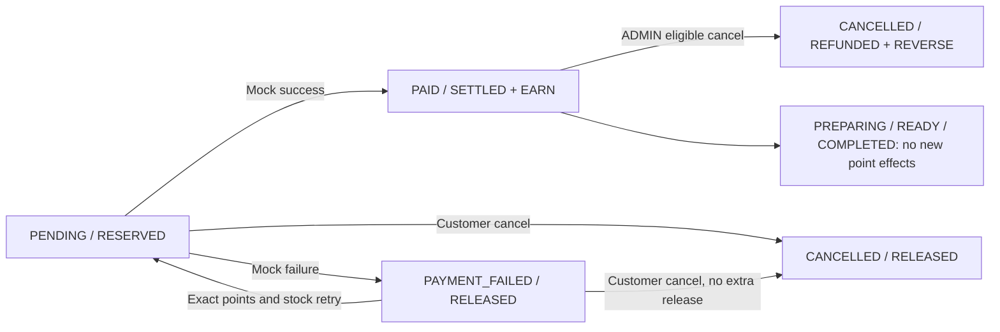

# L00 — Loyalty Direct Redemption Contract

2026-10-14. **L00 CONTRACT FROZEN.** USER APPROVED Z01/B, D01/A, S01/B, A01/B. Documentation only.
L01/A07/B17 are PLANNED. No application/schema/migration/database change. Documentation-only local freeze commit authorized; no push.
Companion: audit and approval requests (evidence lịch sử đã dọn; xem [hướng dẫn hiện hành](NORMAL_SANDBOX_MODE.md)).

## 1. Purpose and scope

Design direct Customer points discount at Checkout, preserving existing pricing,
stock OCC, snapshots, Payment idempotency, Cart and B16 graph. This is a user
extension, not a new PDF requirement. No vouchers/reward wallet/catalog, campaign
engine, percentage/stacked Promotions, manual point grants, queues or background jobs.
The approved policies below are final; the four selected options are explicitly USER APPROVED. Technical details below
complete those options within the authorized scope; no essential blocker remains (§28).

## 2. Requirement and extension mapping

| ID | Classification | Mapping |
| --- | --- | --- |
| EXT-LR01 | APPROVED | Direct Order-level redemption,100 VND/point, optional/default0; FR06/07/15/16 reuse |
| EXT-LR02 | APPROVED | Reserve/settle/release/reacquire/refund lifecycle, exact effects; FR11–14/16 reuse |
| EXT-LR03 | USER APPROVED D01/A | Reverse original award without forgiving spent points; separate debt |
| L00-Z01/D01/S01/A01 | USER APPROVED B/A/B/B | Zero/debt/journal/history package; not new PDF FRs |
| NFR02/04/05/06/07/10 | EXISTING/reuse | Ownership, UI, tests/docs, atomicity and integrity |

Old no-redemption scope in D32/D34/DR14/REQUIREMENTS is superseded in principle by
this user extension, not by a fictitious implementation. Other baseline rules,
including D31 max1 unpaid Order and no cash refund, remain EXISTING.

## 3. Source-of-truth references

[AGENTS](../AGENTS.md), [README](../README.md), [PDF](BrewLite-CongNghePhanMem.pdf),
[REQUIREMENTS](REQUIREMENTS.md), [API](API_DESIGN.md), [database](DATABASE_DESIGN.md),
[architecture](ARCHITECTURE.md), [DECISIONS](DECISIONS.md), [plan](DEVELOPMENT_PLAN.md),
[matrix](TRACEABILITY_MATRIX.md), [review](DESIGN_REVIEW.md), [structure](PROJECT_STRUCTURE.md).
B04 (evidence lịch sử đã dọn; xem [hướng dẫn hiện hành](NORMAL_SANDBOX_MODE.md)), [B05](B05_CATALOG_CONTRACT.md), B06 (evidence lịch sử đã dọn; xem [hướng dẫn hiện hành](NORMAL_SANDBOX_MODE.md)),
[B07](B07_AUTH_CONTRACT.md), [B08](B08_CART_CONTRACT.md), [B09](B09_PRICING_CONTRACT.md),
[B10](B10_ORDER_CONTRACT.md), [B11](B11_PAYMENT_CONTRACT.md), [B12](B12_CHECKOUT_ACCEPTANCE.md),
[B13](B13_PROMOTION_CONTRACT.md), [B14](B14_LOYALTY_CONTRACT.md),
[B15](B15_ORDER_HISTORY_CONTRACT.md), [B16](B16_ORDER_WORKFLOW_CONTRACT.md).
[A00](A00_ADMIN_STAFF_CONTRACT.md), [A01](A01_RBAC_AUTH_CONTRACT.md),
[A03](A03_STAFF_WORKFLOW_CONTRACT.md), [A04](A04_ADMIN_PRODUCT_MANAGEMENT_CONTRACT.md),
[A05](A05_SIZE_TOPPING_MANAGEMENT_CONTRACT.md), [A06](A06_INVENTORY_MANAGEMENT_CONTRACT.md),
[UI01](UI01_ROLE_BASED_INTERFACE_CONTRACT.md). Actual symbols/constraints/read-only
database evidence and discrepancies are listed in the audit, not inferred from reports.

## 4. Current Loyalty behavior — EXISTING

User.loyaltyPoints is a nonnegative PostgreSQL INTEGER; currently earned points
minus reversed awards, with no redemption/reservation/debt fields. GET /loyalty
returns only this stored counter. PaymentService.pay awards floor(Order.total/10000)
once at PAID, including award0; unique LoyaltyAward.orderId and partial unique
successful Payment/order enforce baseline deduplication. B16 reverses stored
award.points once and requires balance>=points; otherwise invariant503 rolls back
Order/stock/award/user together. No signed balance, points ledger or points debt exists.
Inventory reservation is direct Product stock consumption at PENDING, not a separate
reservation table. PricingService is a read-only child of the caller transaction.

## 5. Approved business rules

**APPROVED:** optional direct Checkout redemption, default redeemedPoints0;
nonnegative integer points, any integer including1, no multiples-of10 restriction;
discount applies to whole Order after at most one ordinary FIXED AMOUNT Promotion;
Product/Size/Topping/OrderItem prices remain unchanged. Server decides balance/money.
Reserve at PENDING; settle and earn at PAID; release at PAYMENT_FAILED; retry exact
original points; unpaid cancellation release once; eligible PAID cancellation restores
exact redeemed points and reverses exact original award. Preparation/completion never
repeats financial effects. No vouchers, automatic cash refund or duplicate effects.

## 6. Exchange rate — APPROVED

**1 point = 100 VND**, only rate. Older10-VND/point,10-point-block,20-point-voucher
proposals are obsolete and excluded. Server Decimal multiplication, JSON money strings.
The10000-VND earning threshold and100-VND redemption value are different rules;
earning one point does not mean one redeemed point discounts10000 VND.

| Points | VND discount |
| --- | --- |
| 1 | 100 |
| 10 | 1000 |
| 50 | 5000 |
| 100 | 10000 |
| 500 | 50000 |

## 7. Promotion plus Loyalty — APPROVED

One optional code, both discounts allowed. Validate products/options and subtotal,
then B13 eligibility: active, startsAt<=now<endsAt, subtotal>=minimumSubtotal;
promotionDiscount=min(itemSubtotal, configured fixed discount). Configured Promotion
discount remains positive, actual discount may0 with subtotal0. No percentage/campaign.
Apply points only to totalAfterPromotion. Invalid code422 PROMOTION_INVALID; invalid
points reject explicitly, never clamp selected points or quietly remove the Promotion.

## 8. Pricing and zero policy

```text
itemSubtotal = sum(server-calculated OrderItem.lineTotal)
promotionDiscount = min(itemSubtotal, valid configured fixed discount), or0
totalAfterPromotion = itemSubtotal - promotionDiscount
loyaltyDiscount = redeemedPoints * 100
finalTotal = totalAfterPromotion - loyaltyDiscount
earnedPoints = floor(finalTotal / 10000)
```

All VND are Decimal integers0..999999999999. Requested points must fit the actual
available balance, PostgreSQL INTEGER and payable cap. No client money/owner/rate input.
Final technical bound0..2147483647; max discount214748364700 is within DECIMAL(12,0).
Stale balance insufficient or a Cart mismatch rejects without effects. A changed
balance still sufficient for the exact choice need not invalidate that choice.

Mandatory example: subtotal100000, BREW10K discount10000 → afterPromotion90000;
50 points → loyaltyDiscount5000; final85000; expected earned8. The code configuration
must actually be eligible in each fixture; the code name alone never grants10000.
With initial available100/debt0/held0: creation holds50 and leaves available50;
successful Payment settles that hold and credits8, leaving available58/held0/debt0.

Earning examples35000→3,50000→5,85000→8,100000→10,250000→25 are unchanged.

**L00-Z01: OPTION B — USER APPROVED.** Loyalty may reduce finalTotal to0;
finalTotal must never be negative. No automatic PAID transition. Existing explicit
WALLET/CARD Mock Payment remains mandatory: SUCCESS writes Payment SUCCEEDED amount0,
Order PAID/paidAt and original award0 in one transaction; FAILURE writes FAILED
amount0/PAYMENT_FAILED, releases points and stock, awards nothing. Exact replay,
retry and cancellation still apply. No cash refund or historical snapshot rewrite.
Both zero-total outcomes require new L01 tests; source baseline coverage is not L01 PASS.

With no debt: maxRedeemable=min(availablePoints,2147483647,floor(totalAfterPromotion/100)).
If debt>0, maxRedeemable=0. Never substitute this cap for the selected value.

## 9. Final Order snapshot design — USER APPROVED S01/B

Keep names/meaning: Order.subtotal=itemSubtotal, Order.discountAmount=promotionDiscount,
Order.total=finalTotal. Add redeemedPoints and loyaltyDiscountAmount; do not repurpose
discountAmount as combined discount or alter historical rows. Combined discount is
derived, not another stored field. Payment.amount always original Order.total.
Expected earning derives from frozen total; actual LoyaltyAward.points remains the
stored PAID award. Current effective earnedPoints remains null before award and0
when reversed/cancelled. No need for a duplicated expected-earned DB column.

## 10. Final accounting design — USER APPROVED D01/A + S01/B

Approved: existing User.loyaltyPoints becomes explicitly available/spendable A;
new nonnegative User.loyaltyDebt D tracks outstanding reversal, BIGINT; held R derives
from positive-redemption Orders in RESERVED state, not a duplicated User counter.
Order embeds reservation state/cycle; one small immutable LoyaltyEntry journal
attributes actions. Keep available INTEGER nonnegative and enforce A=0 OR D=0.
Do not make existing loyaltyPoints negative or replace its CHECK.

Within one owner-locked action, credit c: offset=min(D,c), D'=D-offset,
A'=A+c-offset. Debit p: take=min(A,p), A'=A-take,D'=D+p-take.
Credits include new earnings, release of held points and refunds. Debt>0 blocks new
reservation/reacquisition AND settlement of an existing positive-point reservation
(D01/A USER APPROVED). Cash-only redemption0 still earns and pays down debt. Do not use
the same unpaid Order's expected future award to finance its redemption.

| Effect | Nominal points | ΔA | ΔR | ΔD |
| --- | --- | --- | --- | --- |
| RESERVE | r | -r | +r | 0 |
| SETTLE | r | 0 | -r | 0 |
| RELEASE | r | r-offset | -r | -offset |
| EARN | e | e-offset | 0 | -offset |
| REFUND | r | r-offset | 0 | -offset |
| REVERSE | e | -take | 0 | e-take |

earned/spent/released/refunded/reversed are attributed cumulative event totals, not
extra spendable balances. Repeated failed attempts may increase release totals without
creating points. Conservation since migration opening O:
**A + R - D = O + earned - spent + refunded - reversed.**
Also A=opening+ΣavailableDelta,D=ΣdebtDelta,R=ΣreservedDelta=Σheld Order points.
Aggregate with exact BIGINT/NUMERIC, not JS Number; R capped by retained D31.
Read/reconcile under owner lock or consistent read snapshot. Journal is accounting
evidence, not a separate payment/idempotency subsystem.

## 11. PENDING reservation — USER APPROVED lifecycle / final mechanism

Authorize CUSTOMER/owned Cart; normalize syntax/key; completed CREATE_ORDER replay
first; owner lock before FK claim insert; retain D31 active Order guard and full Cart
equality. Reprice options/Promotion, verify A>=r,D=0 for r>0 and amount cap. Reserve
points A-=r, stock CAS by sorted Product IDs, create frozen PENDING Order with
stateRESERVED/cycle1 if r>0 (NONE/cycle0 otherwise), append RESERVE, complete claim201.
All commit/rollback together; no earning/Cart deletion/claim-only commit. No physical
reservation write in preview. Actual effect chronology may retain B10 stock-before-
new-Order insertion; no conflicting existing Order row is acquired in that path.

## 12. PAID settlement and earning

Owner lock/replay first; PENDING with positive redemption must already be RESERVED.
No second A deduction. D01 gate checks D=0 before consuming reserved points.
Same Order CAS writes statusPAID, redemptionStateSETTLED and paidAt/version together.
Store Payment amount snapshot, append SETTLE once, create original award floor(total/
10000), credit through debt-aware helper and append EARN, clear purchased Cart only,
complete PAY_ORDER response200. All one B11 transaction, including award0.
For r0, stateNONE and no SETTLE event. Missing/mismatched reservation/award/accounting
is invariant503, not an invented success or point grant.

## 13. PAYMENT_FAILED release

Same atomic Order CAS moves PENDING/RESERVED to PAYMENT_FAILED/RELEASED; Payment FAILED and
original stock restore stay in B11 transaction. Credit exact r through debt-aware
release, append RELEASE once for this cycle/Payment, award none, keep Cart/snapshot.
r0 remains NONE. Replaying a failed Payment never reserves/releases again.

## 14. Payment retry

New PAY_ORDER key for a new business attempt, same orderId/method shape. Completed
old-key replay before current balance/stock. Under owner lock, positive redemption
PAYMENT_FAILED+RELEASED must have A>=original r,D=0; reserve exact r, increment cycle, reacquire snapshot stock,
same CAS writes PENDING/RESERVED, then ordinary mock result/settle-or-release.
Insufficient points/debt/stock or CAS fault rolls back claim, reservation, stock and
status; Order stays PAYMENT_FAILED/RELEASED, no extra Payment. No points reduction/repricing.
For r0, stateNONE/cycle0 persists; outstanding debt does not block cash-only retry.
Known rejection allows explicit later retry; unknown response repeats original key/body.
D31 still prevents a new Checkout while FAILED exists: other-Order spending during
that retry is not a permitted normal flow. Retain adversarial serialization tests;
do not remove D31 or silently permit multiple active Orders.

## 15. Cancellation and preparation

Customer PENDING→CANCELLED: release held r and stock once; FAILED→CANCELLED: points/
stock already released, no second credit. Current cancel route/key policy unchanged.
ADMIN PAID→CANCELLED only: owner lock/original expectedVersion/CAS; restore stock;
refund exactly selected r from SETTLED→REFUNDED; reverse original award.points once
with original reversedAt guard. Compute refund credit then award debit in exact
arithmetic; store final bounded A,D atomically, append both attributed events.
Refund credit may pay debt rather than increase A; nominal refundedPoints remains r.
Missing/wrong/reversed award, corrupt accounting or stock/version bounds still503/
rollback; never convert unexplained balance corruption into debt.

Repeated CANCELLED is current no-op. r0 stateNONE works for legacy/new Orders.
Payment SUCCEEDED, amount and paidAt remain historical; no cash refund implied.
PREPARING/READY/COMPLETED do not change points; no new graph edges. Existing paid
Order preparation is not blocked merely because the owner later has points debt.

## 16. Spent-award reversal/debt decision

Concrete approved case: A pays100000, earns10 from initial0; B subtotal9000,
uses10→1000 discount, pays8000, earns0. After B PAID, A=0,R=0,D=0. Cancel A:
reverse its10 exactly, record D=10,A=0; A's award is marked reversed, never forgiven.
Cancel B later: refund10 offsets D10→0; reverse B's0; A stays0.
Alternatively C cash payment earns20 while D10: award20, debt offset10, available+10.
If B itself earned points, use its real award when calculating balances; do not
silently omit that earning from the mandatory debt scenario.

### Critical concurrency: paid A reversal versus pending B

Initial0: A PAID earns10; B reserves10, so A=0,R=10,D=0. ADMIN cancellation of A
reverses original10 and creates D10 while B remains PENDING/RESERVED/cycle1.
B's selected10, discount, total, stock consumption and reservation are untouched.
The reservation cannot be forcibly transferred to debt or reduced/repriced.

POST /payments for B: authorize/owned lookup and completed replay first; acquire
owner lock, reread Order and reconcile accounting. For r>0 and D>0 return409
LOYALTY_REVERSAL_OUTSTANDING **before mock.result(), any Payment insert, Order CAS,
stock mutation, point settlement/award or committed claim**. This gate applies
regardless of configured SUCCESS/FAILURE, including total0. Rejection leaves B
PENDING/RESERVED with every counter/stock/version/Cart/claim unchanged. A tentative
PROCESSING claim, if inserted, rolls back; no committed result exists for rejection.
Never write Payment SUCCESS and then discover a blocked settlement. The owner lock
prevents A cancellation from introducing debt between gate and settlement.

Recovery uses EXISTING POST /orders/:id/cancel (CUSTOMER owner, empty body/query):
PENDING B -> CANCELLED/RELEASED, release10 offsets D10 ->0, A remains0, stock restores
once, Cart remains and D31 unlocks. No debt gate is applied to unpaid cancellation.
If D>r, release r reduces debt only; the remainder does not prevent cancelling B
or making a new r0 cash-only Order. Cash payment earnings and eligible paid refunds
offset that remainder. No manual grant, point purchase or new cancellation edge.
If another already-paid Order refund legitimately clears debt before B pays, B may
settle its exact reservation under a new attempt after reading current state.

D31 blocks new Checkout and Cart writes while B is PENDING or PAYMENT_FAILED;
it does not block its existing cancel API, balance/history reads or eligible paid
refunds. Thus cash earning requires cancel B first, not a second unpaid Order.
UI offers `Hủy đơn để giải phóng điểm` linking to existing cancel confirmation,
then fresh balance/Cart and separate Checkout default0. No forced cancellation.

For PAYMENT_FAILED B (already RELEASED), debt blocks retry reacquisition before
mock/stock/Payment; B stays FAILED and existing cancel unlocks D31 without a second
release. Retry preserves method/body/key semantics: known409 has no Payment result;
explicit later attempt after recovery may use a new key, uncertain committed results
must replay the original key/body. Old committed SUCCESS/FAILURE replays precede the
debt gate and return historical bodies with zero new effects; GET gives current state.

Race outcomes: A cancellation wins owner lock -> B Payment409/no effects; B success
wins -> B settles/earns atomically, then A cancellation may create debt from spent
points; B failure wins -> release commits, then A reverses using available points
or debt as exact accounting requires. Cancellation B versus its Payment serializes
under the same owner lock and existing state/version CAS. Tests must force both
orders with barriers. Stock OCC loss/technical faults roll back the entire action.
This is compatible with B11/B16/D31 and approved D01/A; no extra business approval
or schema/status/transition is needed. Future credits serialize on the owner row.

Old invariant A=Σunreversed awards cannot hold after redemption. Replace it only
under D01/A + S01/B with the conservation/journal reconciliation above. B16 exact-award,
valid-owner, single reversal and atomic rollback invariants remain mandatory.

## 17. Final documentation-only schema proposal — USER APPROVED S01/B

No schema.prisma/SQL migration files changed. Existing15 tables would become16
under the approved journal option; no separate redemption table needed.

| Field | Prisma / PostgreSQL | NULL/default | Purpose/lifecycle |
| --- | --- | --- | --- |
| User.loyaltyDebt | BigInt / BIGINT | NOT NULL,0 | Outstanding reversal D; exact0..9223372036854775807 |
| Order.redeemedPoints | Int / INTEGER | NOT NULL,0 | Immutable requested r,0..2147483647 |
| Order.loyaltyDiscountAmount | Decimal @db.Decimal(12,0) / NUMERIC(12,0) | NOT NULL,0 | Immutable100*r |
| Order.redemptionState | LoyaltyRedemptionState / new enum | NOT NULL,NONE | NONE/RESERVED/RELEASED/SETTLED/REFUNDED |
| Order.reservationCycle | Int / INTEGER | NOT NULL,0 | Initial1, retry+1; immutable after terminal settlement/refund |

SQL maps: loyaltyDebt→loyalty_debt; redeemedPoints→redeemed_points;
loyaltyDiscountAmount→loyalty_discount_amount; redemptionState→redemption_state;
reservationCycle→reservation_cycle. LoyaltyEntry maps to loyalty_entries; userId/
orderId/paymentId/availableDelta/reservedDelta/debtDelta/effectKey/createdAt use
user_id/order_id/payment_id/available_delta/reserved_delta/debt_delta/effect_key/
created_at; id/sequence/kind/cycle/points keep their names. All mappings are final design, NOT IMPLEMENTED.

User CHECKs D>=0 and `(loyalty_points=0 OR loyalty_debt=0)`, original A>=0 stays.
Order CHECKs r>=0,l=100*r,0<=l<=subtotal-discount_amount; replace only total CHECK
with `total>=0 AND total=subtotal-discount_amount-loyalty_discount_amount`.
Keep existing promotion/no-promotion CHECK, money types/FK/index/version unchanged.
r0 iff stateNONE/cycle0; r>0 requires cycle1..2147483647 and legal pairs:
PENDING/RESERVED; PAYMENT_FAILED/RELEASED; PAID/PREPARING/READY/COMPLETED/SETTLED;
CANCELLED+paidAtNULL/RELEASED; CANCELLED+paidAtNOTNULL/REFUNDED.
For positive redemptions, PENDING/PAYMENT_FAILED also require paidAtNULL; PAID/preparation/
completion require paidAtNOTNULL. Legacy r0/NONE does not gain a retrospective
paidAt CHECK. These final design checks do not imply a paidAt CHECK currently exists.
Because CHECK is immediate, each status/state/cycle change must be one Order UPDATE,
not two temporary contradictory rows even inside a transaction. No new Order status.
Z01/B retains nonnegative total; no conditional positive-total CHECK.

### Final LoyaltyEntry: immutable effect journal

| Field | Prisma / PostgreSQL | NULL/default | Constraint/purpose |
| --- | --- | --- | --- |
| id | String @db.Uuid / UUID | NOT NULL,uuid | PK, internal |
| sequence | BigInt @default(autoincrement()) / BIGSERIAL | NOT NULL,sequence | UNIQUE; assigned after owner lock for deterministic per-owner ordering; gaps allowed |
| userId | String @db.Uuid / UUID | NOT NULL,no default | FK users RESTRICT; owner history/index |
| orderId | String? @db.Uuid / UUID | NULL only OPENING | FK orders RESTRICT; attribution |
| paymentId | String? @db.Uuid / UUID | NULL depending kind | FK payments RESTRICT; attempt attribution |
| kind | LoyaltyEntryKind / new enum | NOT NULL,no default | OPENING/RESERVE/SETTLE/RELEASE/EARN/REFUND/REVERSE |
| cycle | Int / INTEGER | NOT NULL,0 | RESERVE/RELEASE/SETTLE cycle>=1; other kinds0 |
| points | Int / INTEGER | NOT NULL,no default | Nominal effect0..2147483647; reserve/settle/release/refund>0 |
| availableDelta | Int / INTEGER | NOT NULL,no default | Signed -2147483647..2147483647 |
| reservedDelta | Int / INTEGER | NOT NULL,no default | Signed same bounds |
| debtDelta | BigInt / BIGINT | NOT NULL,no default | Signed actual debt change; calculations exact |
| effectKey | String @db.Text / TEXT | NOT NULL,no default | Stable derived source, not client Idempotency-Key; max96 |
| createdAt | DateTime @db.Timestamptz(6) / TIMESTAMPTZ | NOT NULL,now | Business history; sequence orders causally per owner |

UQ(effectKey,kind), UQ(orderId,kind,cycle); SQL partial UQ(orderId,kind) for
SETTLE/EARN/REFUND/REVERSE ensures one of each even across cycles. Index(userId,
sequence DESC), index(orderId,sequence); existing Order user index supports R sum.
No additional index on User debt required. FKs alone do not enforce matching owners;
the shared writer must verify entry owner=Order owner=Payment owner before insert,
as current Award ownership is checked by B16. No client journal writes/updates/deletes.
Approved SQL-only BEFORE UPDATE/DELETE guard makes journal rows append-only in
ordinary application use; migration insertion remains allowed. Test cleanup must
drop only an owned UUID schema, or explicitly verify an owned test target before
any privileged fixture-cleanup bypass; never disable this guard in public development.

CHECK effect attribution: OPENING key=`OPENING:<userId>`, no Order/Payment,cycle0;
initial RESERVE key=`CREATE_ORDER:<orderId>`,cycle1,Payment NULL;
Payment-derived RESERVE/RELEASE/SETTLE/EARN key=`PAY_ORDER:<paymentId>`;
unpaid cancellation RELEASE key=`UNPAID_CANCEL:<orderId>`,Payment NULL;
REFUND/REVERSE key=`PAID_CANCEL:<orderId>`,cycle0,Payment NULL.
Source strings must equal the row's canonical UUID-based expression, not arbitrary
caller keys. EARN/SETTLE require Payment; retry RESERVE cycle>1 requires Payment;
service checks the correct successful/failed Payment and original Order r/award.

CHECK per-kind deltas match §10; OPENING has availableDelta=points,Rdelta=Ddelta=0.
EARN/REFUND: availableDelta>=0,debtDelta<=0,availableDelta-debtDelta=points;
REVERSE: availableDelta<=0,debtDelta>=0,-availableDelta+debtDelta=points;
RELEASE also reservedDelta=-points; RESERVE/SETTLE exact deltas per table.
Cast to NUMERIC/BIGINT before SQL100*r/signed CHECK arithmetic; do not overflow an
INTEGER expression. A cancelled action's credit/reversal is one atomic effect group;
temporary arithmetic values are not persisted as User balance. Validate final
counter bounds without silently clamping or rejecting solely due intermediate
refund-then-reversal overflow when the final value is valid.

Other models: no OrderItem/Payment/LoyaltyAward price/points changes, no Idempotency
enum/CHECK change. Payment/Award uniqueness stays. Journal enables full attribution;
cross-row aggregate/state/owner invariants remain service+test responsibilities, not
misrepresented as row CHECK guarantees. Future migration DDL details require review.
Prisma reverse relations would add User/Order/Payment.loyaltyEntries arrays only;
these are navigation relations, not additional stored columns. Journal aggregate
proof is mandatory before treating insufficient available points as an explained
reversal shortfall; unexplained corruption still rolls back with invariant503.


### Exact local journal constraints and reservation-cycle linkage

Two new enums only: LoyaltyRedemptionState NONE/RESERVED/RELEASED/SETTLED/REFUNDED,
LoyaltyEntryKind OPENING/RESERVE/SETTLE/RELEASE/EARN/REFUND/REVERSE. No new debt enum:
debt-created/offset is the signed debtDelta on the attributed event, never a second
balance-changing event. No independent loyalty version; existing owner lock, Order
version/status CAS, Award.reversedAt and journal UQ define exactly-once semantics.

All journal FKs use ON DELETE RESTRICT / ON UPDATE CASCADE, matching retained UUID
relations; no cascade deletion of history. PK UUID generated by application UUID
default; sequence BIGSERIAL UNIQUE and CHECK sequence>0; no sequence recycling.
CHECK points0..2147483647, cycle0..2147483647, signed deltas within documented bounds,
length(effect_key)1..96. Every non-OPENING row requires orderId; OPENING iff orderId
NULL, paymentId NULL, cycle0, debt/reservedDelta0 and availableDelta=points.
RESERVE/SETTLE/RELEASE require positive points/cycle>=1; REFUND positive points/cycle0;
EARN/REVERSE allow0/cycle0. EARN/SETTLE and retry RESERVE require paymentId;
RELEASE uses NULL for unpaid cancel or failed Payment id; REFUND/REVERSE have NULL
paymentId; initial RESERVE has NULL. CHECK enforces exact source expressions (§17).

RESERVE: availableDelta=-points,reservedDelta=points,debtDelta=0.
SETTLE: availableDelta=0,reservedDelta=-points,debtDelta=0.
EARN/REFUND: reservedDelta=0,0<=availableDelta<=points,
-points<=debtDelta<=0,availableDelta-debtDelta=points.
RELEASE: same credit identity plus reservedDelta=-points.
REVERSE: reservedDelta=0,-points<=availableDelta<=0,
0<=debtDelta<=points,-availableDelta+debtDelta=points.
OPENING uniqueness from canonical effectKey+kind prevents two openings per User;
UQ(orderId,kind,cycle) plus partial UQ terminal kinds prevents duplicate effects.
No extra User debt index/counter/table, no IdempotencyRequest field or enum change.
These are technical correctness constraints covered by S01/B, not pending approval.

Initial reserve cycle1 links CREATE_ORDER UUID; retry preallocates Payment UUID after
gate and successful reacquisition, inserts Payment before its FK-bearing entries in
the same transaction. Append retry RESERVE before its SETTLE/EARN or RELEASE in
sequence order. No Payment is committed just to satisfy journal FK. Rollback restores
cycle/stock/reservation/claim; sequence gaps are not missing business events. Guard
cycle overflow before any effect. Failed retry cycles advance once per committed
Payment attempt, never per HTTP replay or rolled-back attempt.

Per Order r>0: exactly one RESERVE in each committed cycle; earlier cycles have one
failure RELEASE, current RESERVED has no SETTLE/RELEASE yet; current RELEASED has
one RELEASE, current SETTLED/REFUNDED one SETTLE and no RELEASE. REFUND once only
after SETTLE, EARN once per successful Order (including0), REVERSE once only matching
original stored Award and reversedAt. r0 never produces reserve/settle/release/refund
rows; it still journals EARN/REVERSE after cutover. Legacy already-paid awards have
no fabricated EARN, and later REVERSE remains valid against OPENING+stored Award.
No restriction that reserve journal counts equal total spending across failed cycles.
Each credit uses min(current debt, nominal credit); reversal draws available first
then creates debt; reconcile before action. The full journal prefix and held Order
sum, not just conservation alone, must match A/D/R and the Award/Payment sources.
Debt is global, not per-award lots; rows attribute origin and offseting credit, with
no invented mapping from a credit to a particular debt lot.

## 18. Final API package — USER APPROVED A01/B

All protected Customer operations retain JWT+DB CUSTOMER, owner-only, no-store,
no arbitrary userId/rate/money input. Existing error envelope; old faults/codes remain.

| Method/path | Final design changes / exact new fields |
| --- | --- |
| POST /orders | Existing items/promotionCode? + redeemedPoints? default0; number integer0..2147483647, null/string/fraction rejected; mandatory existing key |
| POST /orders response201 | Existing frozen DTO + redeemedPoints:number, loyaltyDiscountAmount:money string, redemptionState, estimatedEarnedPoints:number |
| GET /orders/:id | Same additions + existing paidAt/effective earnedPoints/paymentStatus; current state, immutable amounts |
| GET /orders/me | Existing summary + redeemedPoints,loyaltyDiscountAmount,redemptionState; preserves sort/owned scope |
| Operator reads/B16 action response | Same snapshot discount fields so totals explain correctly; never expose customer balance/debt/entries; STAFF scope unchanged |
| POST /payments | Input/hash unchanged; amount from frozen total; existing loyalty.awardedPoints still total earned, not merely available increment |
| Payment response200 | New committed results require additive loyalty fields redeemedPoints:number,redemptionState:enum,debtOffsetPoints:number,availablePointsAdded:number; old saved replay may omit them; current GET required |
| GET /loyalty | Existing loyaltyPoints=A retained; add reservedPoints:number,outstandingReversalPoints:canonical BIGINT string,pointValueVnd:"100" |
| POST /orders/preview | New read-only quote, same create body; no Idempotency-Key requirement, no Order/claim/reserve/write;200 fields below |
| GET /loyalty/transactions | CUSTOMER-only read-only journal; query limit?,cursor? only, empty body;200 `{scope:"SINCE_L01_CUTOVER",items:[...],nextCursor:string\|null}`; bounded stable sequence DESC (§18 below) |

For a new Payment result, redemptionState reflects its current committed state;
redeemedPoints is original r. debtOffsetPoints and availablePointsAdded are exact
nonnegative INTEGER-sized credit deltas from EARN on SUCCESS or RELEASE on FAILURE
(both0 when that action has no credit). awardedPoints remains full original earning
on SUCCESS and0 on FAILURE, even when the credit offsets debt. New results include
all four additions; old stored replay stays byte-for-byte unchanged. Order creation/
detail adds four fields as listed, history summaries add the listed three; operator
reads and B16 action detail add redeemedPoints,loyaltyDiscountAmount,redemptionState,
estimatedEarnedPoints, without User debt/balance or journal internals.

Preview response example (balance100):

```json
{
  "currency": "VND", "itemSubtotal": "100000", "promotionCode": "BREW10K",
  "promotionDiscount": "10000", "totalAfterPromotion": "90000",
  "redeemedPoints": 50, "pointValueVnd": "100", "loyaltyDiscount": "5000",
  "finalTotal": "85000", "earnedPoints": 8, "availablePoints": 100,
  "availablePointsAfterReservation": 50, "reservedPoints": 0,
  "outstandingReversalPoints": "0", "maxRedeemablePoints": 100
}
```

Order additions for the same example: subtotal"100000",discountAmount"10000",
redeemedPoints50,loyaltyDiscountAmount"5000",total"85000",stateRESERVED,
estimatedEarnedPoints8. Request sends only items/promotionCode/50, never these totals.
Preview is a consistent RepeatableRead READ ONLY transaction (final technical design, unlike
current mutation default ReadCommitted), same validation and D31; expires logically
as soon as data changes, no quote token/lease/guaranteed reservation. Creation always
revalidates inside its owner-locked transaction. Money strings, no Float.
Updated parsers must validate the100*r breakdown/final-total equation and match
the submitted points on a positive-redemption response; do not default malformed
new positive-point results to legacy0. Estimated earning is preview/unpaid information,
never a replacement for the original actual LoyaltyAward on historical PAID Orders.

### CUSTOMER history DTO, sorting and paging

GET /loyalty/transactions requires verified JWT and current DB CUSTOMER role;
identity is req.user.id only. No userId path/query/body, no operator impersonation.
History is SELECT-only; never updates balance/debt/timestamps/claims/journal.
Cache-Control: private, no-store, max-age=0; Vary: Authorization (preserve Origin).

Query DTO: `limit?` one canonical decimal integer string1..50 (default20), `cursor?`
one opaque nonempty base64url string max512 chars. Repeated/unknown query fields,
body fields, limit0/51/fraction/signed/leading-zero values, malformed/tampered or
other-owner cursor ->400 VALIDATION_ERROR. Missing/invalid/expired JWT401 UNAUTHORIZED;
valid non-CUSTOMER403 FORBIDDEN. Storage/invariant fault503 SERVICE_UNAVAILABLE;
no history rows200 empty items and nextCursor:null, not404. Existing error envelope
`{error:{code,message,details?}}`, sanitized messages; no DB/internal metadata.

Response item exact fields:
`{kind,orderId,orderCode,points,availableChange,reservedChange,
outstandingReversalChange,debtOffsetPoints,debtCreatedPoints,createdAt}`.
kind is OPENING/RESERVE/SETTLE/RELEASE/EARN/REFUND/REVERSE; points is nominal integer;
availableChange/reservedChange signed integers; debt change signed canonical decimal
string; debtOffsetPoints/debtCreatedPoints nonnegative decimal strings derived from
negative/positive debtDelta respectively. createdAt ISO8601 UTC. Order id/code are
owned Order snapshot identifiers, NULL only for OPENING. Do not expose internal
journal id/sequence, effectKey, userId, Payment/claim/key/hash or arbitrary metadata.
No separate debt event duplicate: debt offset/creation is attributed on the credit
or reversal row. For example RELEASE points10 with offset10 shows availableChange0,
reservedChange-10, outstandingReversalChange"-10", debtOffsetPoints"10".

Stable order is sequence DESC (unique), never timestamp alone. First page chooses
owner's highest committed sequence U in the same RepeatableRead READ ONLY snapshot
as page reads. Query owner AND sequence<=U; continuations also sequence<previous
last sequence, limit+1 to determine hasMore; return at most limit. nextCursor is
NULL at end. Cursor privately carries version1, verified owner UUID, U and last
sequence as canonical BIGINT strings; authenticated encryption AES-256-GCM,
random12-byte nonce,16-byte tag, domain-separated key derived from configured
JWT_SECRET using HKDF-SHA256 (empty salt, info `BrewLite:LoyaltyHistory:v1`, output32 bytes),
no new secret/table. Encode nonce+ciphertext+tag as base64url; authenticated plaintext
is canonical JSON with only version/owner/U/last, bounded types/length. Validate bounds
0<last<=U<=9223372036854775807 and owner after decrypt; reject before querying.
Cursor is a paging position, never authority: always apply JWT owner predicate.
Secret rotation invalidates cursor400 and UI restarts first page. Page size may
change within1..50 without changing U. New commits above U appear only on refresh,
so no duplicates/skips from concurrent inserts; sequence gaps are legitimate.
Index(userId,sequence DESC) supports bounded queries, no OFFSET/unlimited query.
Paging refinement is technical completion of the user's explicit limit/ordering
requirement, within A01/B; no extra business decision/schema expansion.

Each page uses one consistent read snapshot; a transaction's refund/reversal are
committed together, though page boundaries can split those two records. The journal
is never read as a partial committed write. UI does not infer totals by summing one
page; balance remains GET /loyalty. History starts at cutover; OPENING is explicitly
`Số dư đầu kỳ`, never fictional earning. Earlier actual Awards/Order history remains
available via existing Order history, no fabricated reserve/spend events.

Expanded GET /loyalty must read A,D and R from one SQL snapshot (single projection
with held sum, or RepeatableRead READ ONLY), not separate READ COMMITTED queries
which could mix pre/post-reservation values. Journal reads likewise use a consistent
snapshot; a committed cancellation's refund and reversal belong to one committed
transaction, with paging-boundary behavior explicitly defined above.

Final additive business errors:400 VALIDATION_ERROR for malformed points;409
LOYALTY_INSUFFICIENT_POINTS,LOYALTY_REDEMPTION_EXCEEDS_TOTAL,
LOYALTY_REVERSAL_OUTSTANDING. No business auto retry/clamp. Reload balance/preview
and ask a new selection; preserve request amount. 503 PAYMENT_UNAVAILABLE for Payment invariant/bounds/technical rollback;
503 SERVICE_UNAVAILABLE for Order/preview/balance/history invariant or technical faults. Existing401/403/404/409 stock/active/idempotency and422 Promo unchanged.

## 19. Final idempotency integration, no new operation needed

Reuse CREATE_ORDER and PAY_ORDER; ADJUST_INVENTORY untouched. For r0 compute exactly
the legacy CREATE_ORDER hash `{items,promotionCode:...??null}`; absent/explicit0 are
normalized identically. For r>0 include redeemedPoints in canonical hash. This lets
old committed keys replay exact original status/body without schema/hash backfill;
changing redemption under that key cannot replay the wrong discount. Never hash
balance/current prices/debt/time/preview. PAY_ORDER hash stays `{orderId,method}`.
Old saved response bodies are not rewritten/enriched; clients accept missing new
fields only as legacy0 and GET current resource. New positive-redemption response
must supply a validated breakdown, not be mistaken for legacy.

Same create key replay reserves zero extra; same Payment replay settles/earns/releases
zero extra; failed business attempt new key cycles r exactly once. Cancellation uses
existing owner lock/status+version/no-op and journal uniqueness, not a new key namespace.
Journal uniqueness is a durable effect guard, not a standalone idempotency subsystem.
Reject/technical failure rolls back newly inserted claim/events. After unknown result
same key/body; one existing recovery read after rollback, no blind mutation retries.

## 20. Final transaction and locking design

Positive-redemption lifecycle below; r0 uses NONE throughout. Discount snapshot
never changes on these edges. Debt gate before mock/settlement is USER APPROVED D01/A (§16).



Preserve Q19: pool50ms, transaction400ms, lock200ms, statement300ms. ReadCommitted
mutation transactions with the same User FOR UPDATE already used by Cart/B10/B11/B16.
No new Customer-wide advisory/global lock or loyalty version required.

Mandatory dependency: authorize/syntax/nonlocking replay read → owner User lock
before FK claim/event insertion → reread owned Order/accounting → existing Order
row lock when applicable → Product IDs ascending CAS → Order status/state/version CAS
and Payment/Award/
entry/result writes in same transaction. Existing Order row locking precedes Product acquisition; retry can retain B11
stock-before-status-CAS chronology. New Order insertion may remain after stock
CAS as B10; no conflicting pre-existing Order lock. Actor for B16 is Customer owner,
not Admin; A06 actor is Admin and never then locks Customer. Cart still User→Product
SHARE→sorted Topping SHARE. Do not add Product/Topping→User paths or Promotion locks.
No sub-helper commits independently. Return sanitized409/503, not PostgreSQL errors.

| Required race | Final design outcome / retained baseline |
| --- | --- |
| Two Checkouts / two devices same owner | User lock+D31; one PENDING/reservation, second owned active-order409, replay first |
| Checkout vs PAID cancel | Serialize same owner; debt/reservation gate checked after lock; stock CAS independently |
| Checkout vs failed retry | D31 blocks new Order; same owner serialization, exact snapshot retry |
| Duplicate success | Replay/PAY UQ/one successful Payment/one Award/one SETTLE-EARN effect |
| Failure vs retry | Serial valid graph; old failure replay no writes; new retry reserves next cycle |
| Paid cancel vs earning | Owner lock; refund/reverse/credit-to-debt complete atomically in either order |
| Order vs Product/A06 adjustment | Existing stock version CAS winner; loser rolls back points and claim too |
| Redemption vs reversal | No negative A; explained shortfall becomes D only after reconciliation |
| Promotion deactivate/edit vs create | B09 read-time validity/snapshot retained; no commit-time revocation promise |
| Two failed retries | Same owner/Order CAS; at most one success; serial mock failures each have distinct Payment/cycle |

Rollback invariant: all owner counters, Order state/version, stock/version, Cart,
Payment, Award, entries and claim equal pre-state after any failed action. Avoid
merely sequential tests; real barriers force reads and competing commits in L01.

## 21. Final Customer UI design

Keep current /cart Checkout, /loyalty and confirmation/history. Input default0,
explicit optional maximum action requests/selects server cap, never silently applies
points. Show100 available→10000 VND equivalent; select50→5000 discount, subtotal
100000, BREW10K10000, final85000, expected earn8; quote available-after-reserve50.
Quote is labelled preview; only confirmed Order snapshot governs Payment. No guessed
Promotion discount from code name; new preview is needed for accurate pre-Order
Promotion+points breakdown. No PENDING creation probe on mount/input change.

Debounce/abort quote reads, disable mutation while pending/recovery, session isolation.
After known validation failure retain the chosen number visibly, refresh authoritative
data and require correction; after lost create persist original redeemedPoints/key/
payload in existing recovery context. Current writeOrderContext strips unknown fields
and MUST be extended in L01. Freeze point input after PENDING; failed retry retains
exact r; cancel then a separate new Order may begin with default0.

/loyalty shows available/held/points-to-offset and100VND rate; credit-offset explanation,
fresh no-store reads, loading/empty/errors/auth/403/account switch. Approved history shows simple labels `Điểm thưởng`, `Giữ điểm`, `Đã dùng`,
`Giải phóng điểm`, `Hoàn điểm`, `Thu hồi điểm`, and attributed `Bù nghĩa vụ điểm`/
`Phát sinh nghĩa vụ` badges when debt deltas exist. Show nominal points, actual
available change, held/debt change when nonzero, time and owned Order link.
First page20, `Xem thêm` via nextCursor, refresh resets pages; retain loaded rows on
load-more error with Retry, clear rows/cursor on logout/account switch. Opening label
and since-cutover notice, separate fresh balance, loading/empty/401/403/error states.
Retain Order-history link. No vouchers or manual point adjustment controls. Verify390/768/
1366, keyboard/focus/labels/live errors and screen reader; no current PASS claim.

## 22. Security invariants

CUSTOMER own points only; DB role authoritative, ADMIN/STAFF cannot call redemption
or grant points. ADMIN paid-cancel stays its explicitly authorized wrapper of B16;
STAFF preparation/read scope unchanged. Reject userId/balance/total/rate/status/
discount injection. Server recomputes, checked Decimal/BIGINT, available never negative,
debt gates point consumption, exact snapshot Payment, no double settle/release/refund/
earn/reverse. Raw SQL/keys/claim/journal effect IDs never public. No debug routes,
current prices used only for new creation/quote, never historical repricing.

## 23. Backward compatibility

Old Orders r0/l0/NONE/cycle0; totals/prices/Payment amounts/Award points/history
unchanged. Old PENDING stock claims remain, no artificial points reservation. Old
replays retain bytes/status and r0 legacy hash. Same deployment updates frontend
types/parsers/summary/recovery and operator snapshot labels. Old clients may ignore
additive fields, but cannot explain a new redeemed Order correctly: do not promise
full old-UI support for new positive-redemption rows. No snapshot recompute/backfill
award from current price/formula. Existing Auth loyaltyPoints remains available
counter hint; authoritative fresh balance is GET /loyalty.

## 24. Future migration safety — not executed in L00

1. Inspect current constraints, all seven applied migration checksums, balance-to-
   effective-award equality, owners, Payment amounts, graph/active-order anomalies.
2. Investigate mismatches; never auto-fix historic amounts/points or create debt from
   an unexplained pre-migration discrepancy. Current read-only audit found zero mismatches.
3. In separately assigned L01 under S01/B,D01/A,Z01/B, append migration for User debt, Order fields, new enums/
   entries and replacement total CHECK; no applied migration edits/FK/index removals.
4. Backfill r/l/cycle0,NONE,debt0 only. Insert one OPENING entry per existing User at
   actual stored A, no invented historical events; future new Users default0 can have
   implicit opening0, avoiding a gratuitous Auth registration mutation.
5. Pause writes during cutover snapshot/backfill; test owned schema with legacy PAID/
   FAILED/PENDING/CANCELLED/award0/old claims and exact old-column fingerprints.
6. Verify new CHECK/UQ/FK, cache/journal reconciliation, both original claim operations
   and A06; generate/validate/status and full regression only in separately assigned L01.
7. Apply development only after approved isolated proof. Rollback action errors fully;
   once journal accounting is active, even r0 earning requires compatible writers.
   Do not run old writers against new totals/debt/journal reconciliation.
   Disable mutations/restore compatible application, not reset/drop data/reverse snapshots.

## 25. Required L01 acceptance matrix — NOT RUN

E=existing test coverage inspected, N=new L01 automated/PostgreSQL coverage,
B=real browser/manual coverage. E does not mean a test was executed in L00.
E+N denotes baseline portions already covered plus new redemption assertions still
required; it does not classify settlement/debt/reservation as currently implemented.

| ID | Scenario / expected | Coverage |
| --- | --- | --- |
| P01 | No Promo/r0 legacy total/award/shape/replay | E+N |
| P02 | Promo only, cap < = > subtotal, zero, eligibility boundaries | E+N |
| P03 | Loyalty only, Order-level no item price change | N+B |
| P04 | Promo+Loyalty100000-10000-50*100=85000, earn8 | N+B |
| P05 | r1/10/50/100/500→100/1000/5000/10000/50000 | N |
| P06 | Earning35000/50000/85000/100000/250000→3/5/8/10/25 | E+N |
| P07 | Insufficient/stale balance explicit, exact choice retained | N+B |
| P08 | Points > payable, Promo covers most/all, no clamp | N+B |
| P09 | Decimal max, r max, negative/string/null/fraction/NaN/overflow | E+N |
| P10 | Z01/B Loyalty total0 Mock SUCCESS amount0/award0 and FAILURE amount0/release/stock; no auto-PAID; retry/replay/cancel0 | E+N+B |
| P11 | Cart qty/config drift; manipulated total/rate/balance | E+N+B |
| P12 | Preview consistent/read-only, stale preview never authorizes creation | N+B |
| L01 | PENDING deduct A/hold R/stock once, no award, record snapshot | N+B |
| L02 | PAID settle R once, total award once incl0, credit debt first | E+N+B |
| L03 | Mock failure releases r/stock once, snapshot/Cart kept | E+N+B |
| L04 | Retry reacquires exact r/current balance and original stock snapshot | E+N+B |
| L05 | Retry insufficient/debt/stock keeps FAILED/released, no extra Payment | E+N+B |
| L06 | Multiple failures cycles/entries exact, release totals not balance | N |
| L07 | PENDING cancel releases; FAILED cancel no duplicate; repeated no-op | E+N+B |
| L08 | PAID cancel refund r/reverse original e, stock, Payment history retained | E+N+B |
| L09 | A earn10/B spend10/A cancel/D10/B refund→D0 | N+B |
| L10 | A reversal while B RESERVED: A0/R10/D10; gate before mock and Payment for SUCCESS/FAILURE/total0; B cancel offsets10/unlocks D31, no snapshot changes | N+B |
| L11 | New earnings/refunds repay D first; no forgiven debt/negative A | N+B |
| L12 | Legacy stored award differs from current formula, reverse original only | E+N |
| L13 | Missing/wrong/already-reversed award or corrupt cache remains503 | E+N |
| L14 | Prep/ready/completed never settle/earn/release again | E+N+B |
| L15 | A/D/cycle/sequence bounds; atomic refund+reverse with bounded final counter | N |
| C01 | Simultaneous Checkouts/two devices, D31/owner serialization | E+N+B |
| C02 | Same CREATE key concurrent/replay, r changed conflict | E+N+B |
| C03 | Legacy create hashes/omitted0/explicit0 old-body replay | N |
| C04 | Same/different PAY keys duplicate success/failure, unique effects | E+N+B |
| C05 | Failure/retry and two retries with barriers, valid serial graph | E+N |
| C06 | Retry vs new Checkout/D31 and adversarial point use | E+N |
| C07 | Barrier races A reversal vs B pending Payment: both lock winners; Payment409 no effects or prior settle/failure then exact reversal; cancel vs earning/refund | E+N |
| C08 | Product/Size/Topping/A06 mutation vs stock+points claim | E+N |
| C09 | Promo expiry/edit/deactivate during creation vs frozen retry | E+N |
| C10 | Fault after EACH counter/stock/Order/Payment/Award/entry/claim/Cart write | E+N |
| C11 | Deadlock/lock timeout/409 no blind business retry | E+N |
| C12 | Lost create/payment/cancel response original key/current GET, no duplicate | E+N+B |
| S01 | Ownership/userId injection/CUSTOMER-only, STAFF/ADMIN403, guest401 | E+N+B |
| S02 | Forged role/expired JWT/DB demotion reflected next request | E+N |
| S03 | Malformed DTO, client rate/total/balance/status, no internal keys | E+N |
| S04 | Immutable journal/cycle/effect UQ/row CHECK/source/owner consistency | N |
| S05 | No unauthorized manual points or public mutation/debug endpoint | E+N |
| S06 | Account switching/storage failure/stale reads no false success | E+N+B |
| R01 | B04–B16, A01–A06, UI01 tests/lint/build/Prisma retained | E+N |
| R02 | Product OCC/B13 cap/B11 retry/A03 paid-cancel/Cart/snapshots/Staff scope | E+N+B |
| R03 | Legacy migration fingerprints/all original FK/UQ/old amounts/claim bodies | N |
| R04 | Opening/new User0; A/D/R reconciliation, conservation and per-Order cycles, corrupt delta/owner/cache detection, no fabricated history | N |
| R05 | 390/768/1366, keyboard/focus/labels/history/quote/recovery | B |
| R06 | NFR01/Firefox/human QA/screen-reader evidence separately recorded | B |
| L16 | D>r cancellation pays part of debt; new r0 cash Order earns toward remainder; no D31 trap, no point financing/new edge | N+B |
| L17 | FAILED+debt retry gate/no new Payment/stock/cycle; cancel without second release; known409 vs unknown replay UX | N+B |
| S07 | History own rows only; JWT401, roles403, injected/other-owner cursor400, no key/PII leak, read-only fingerprints | N+B |
| S08 | Default20/max50; invalid/repeated query/body400; sequence DESC/timestamp ties/gaps, all pages no duplicates/missing rows; new commits above U only on refresh | N+B |
| S09 | Cursor tamper/owner/bounds/secret rotation; empty/end pages; atomic group across page boundary; account switch/load-more errors | N+B |
| S10 | Attributed EARN/RESERVE/SETTLE/RELEASE/REFUND/REVERSE/debt offset/create; replay/cycle uniqueness and append-only UPDATE/DELETE rejection | N |
| R07 | Legacy PAID cancellation after cutover reverses stored original award via opening; legacy pending payment journals new EARN, old failed retry r0; old replay bytes unchanged | N |


## 26. A07 compatibility

Current B13 one FIXED AMOUNT code unchanged. A07 still planned ADMIN management,
immutable code/config version policy, no engine dependency on L00 journal. Creation
validates options→subtotal→Promo→points→total→atomic stock/points reservation.
Later Promo edit/deactivate/expiry never revokes/reprices an existing Order or retry.
Campaign grouping is a possible future A07 decision only; no Campaign entity here.

## 27. L01 boundary

After explicit full approval/freeze AND a subsequent L01 assignment: update allowed
schema/API/engines/UI/tests/docs in small verified tasks; verify isolated migration
before development. Implementation needs a separate explicit assignment; freeze is not runtime completion. No A07/B17/vouchers/cloud/refund
service/ingredient inventory. Existing regressions remain mandatory; L00 executes
only read-only audit and document consistency checks, no feature PASS claim.

## 28. USER APPROVED decisions and freeze gate

| ID | Final approval | Contract effect |
| --- | --- | --- |
| L00-Z01 | OPTION B — USER APPROVED 2026-10-14 | finalTotal>=0; ordinary explicit Mock0 SUCCESS/FAILURE |
| L00-D01 | OPTION A — USER APPROVED 2026-10-14 | separate nonnegative BIGINT debt; credit offset first; no reserve/reacquire/settle r>0 while indebted |
| L00-S01 | OPTION B — USER APPROVED 2026-10-14 | four Order fields, User debt, two enums, one append-only journal |
| L00-A01 | OPTION B — USER APPROVED 2026-10-14 | additive DTOs/preview/balance plus CUSTOMER journal history with bounded paging |
| Technical constraints/index/guard/cursor/lock details | Final technical design within approved scope | Needed for correctness/security, no additional stored model or business policy |

Consistency review (documentation only): B11 explicit zero Payment/atomicity preserved;
B16 eligible PAID cancel keeps graph/original award/Payment/paidAt; D31 retains one
unpaid and existing cancellation escape (§16); A06 claim namespaces/result CHECK
unchanged; stock OCC remains sorted/shared version/rollback; debt+held gate before
mock and legitimate cancel/recovery defined; schema/API fully specified; opening and
legacy0 backfill preserve old financial columns/claims; no essential BLOCKED choice.
L01 matrix §25 is NOT RUN; migration/implementation/evidence remain future work.

**L00 CONTRACT FROZEN.** Documentation-only local commit:
`docs: freeze BrewLite loyalty redemption contract`. Stop after L00; no L01/A07/B17
implementation or push. L01 design is ready for a separate assignment.
