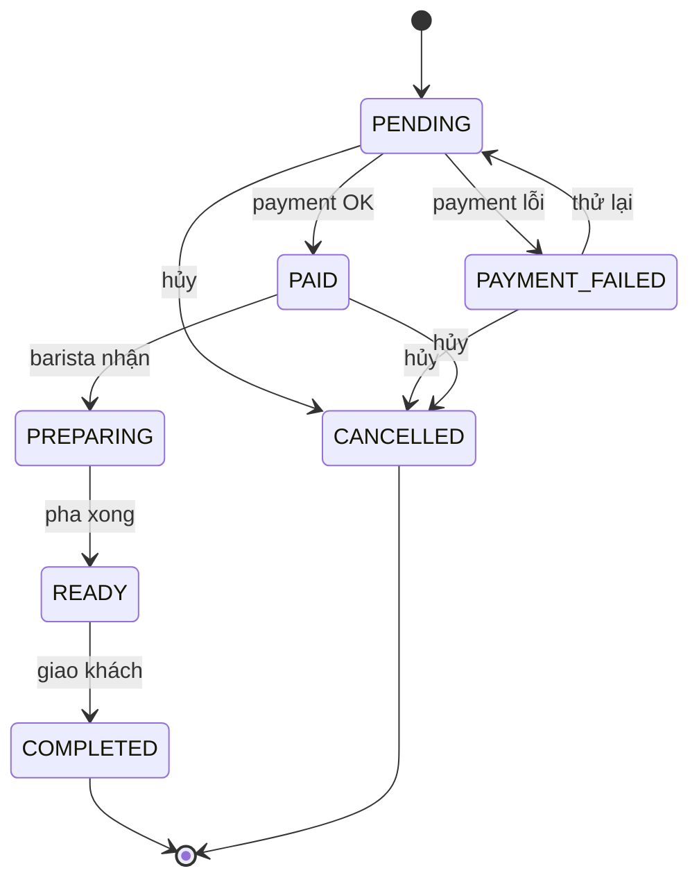

# BrewLite — Yêu cầu và phạm vi

PDF là baseline bất biến. Các bảng FR01–16/NFR01–10/BR01–14 và graph dưới đây giữ nội dung nguồn đã phân tích; chúng không đồng nghĩa tất cả đã nghiệm thu.

**Thiết kế hiện hành được owner duyệt bổ sung:** B08 Cart authenticated PostgreSQL thay strategy client persistence; D31 một active unpaid Order/user; A01–A06/UI01 mở rộng CUSTOMER/STAFF/ADMIN; L00/L01 redemption/journal/debt; P00/P01 VNPAY Sandbox optional. A07 Campaign/Admin Promotion Management đã hủy, promotion B13 vẫn còn. Các giới hạn “không staff/đổi điểm/webhook” ở phần baseline chỉ mô tả phạm vi PDF trước extension, không phủ nhận source hiện tại.

Checkout hiện nằm tại `/cart`; route `/checkout` trong bảng màn hình là tên dự kiến của thiết kế ban đầu. [Architecture](ARCHITECTURE.md), [API](API_DESIGN.md), [Decisions](DECISIONS.md) và [Traceability](TRACEABILITY_MATRIX.md) mô tả mapping hiện hành. Compose/NFR/browser/full handover vẫn cần nghiệm thu theo [plan](DEVELOPMENT_PLAN.md).

## 1. Nguồn và cách đọc

**B10 implementation decision:** D31 adds a user-confirmed orchestration constraint, not a PDF requirement change: one active unpaid Order/user (PENDING/PAYMENT_FAILED), matching full persistent Cart to normalized create request; Cart preserved at PENDING and locked for writes until unpaid resolved. Payment-failure preservation/clear only after payment success remains baseline FR08/BR04. Creation/read/cancel-unpaid evidence at [B10](B10_ORDER_CONTRACT.md); Payment/Loyalty/full workflow remain later scope.

**B08 user decision (2026-10-07):** phần yêu cầu PDF/FR03 dưới đây được giữ nguyên để truy vết. Strategy triển khai Cart client/sessionStorage, guest Cart và mapping “không Cart API/bảng” cũ được **SUPERSEDED** bởi quyết định người dùng: authenticated PostgreSQL Cart, bốn protected endpoints, frontend chỉ UI/cache. Đây là thay đổi thiết kế được người dùng xác nhận, không sửa PDF hoặc thêm/bỏ FR. Contract hiện hành tại [API_DESIGN §13](API_DESIGN.md#13-cart--b08-user-decision), [DECISIONS D29](DECISIONS.md#d29--b08-persistent-cart-accepted-user-2026-10-07).

Nguồn đã đọc toàn bộ: [BrewLite-CongNghePhanMem.pdf](BrewLite-CongNghePhanMem.pdf), VER 1.0, Trường Đại học Sài Gòn, học kỳ I 2026–2027, 8 trang PDF. Đường dẫn được yêu cầu `docs/BrewLite-Requirements.pdf` không tồn tại; repository thực tế chỉ có PDF trên trong `Docs/`. Giữ nguyên tên nguồn và thư mục hiện có; Windows không phân biệt `docs/` với `Docs/`, nhưng khi chuyển sang Linux phải dùng đúng chữ hoa/thường.

Quy ước tham chiếu: `§` là mục của đề bài; `pPDF` là vị trí trang tính cả bìa. Số trang in trong đề bằng pPDF trừ 1, ngoại trừ bìa. Mã FR/NFR/BR dưới đây là mã phân tích, không phải mã gốc của PDF.

| Nhãn | Ý nghĩa |
| --- | --- |
| Bắt buộc | Có trong yêu cầu, tiêu chí chấp nhận hoặc tiêu chí chấm của PDF |
| Đề xuất | Cách hiện thực để đáp ứng yêu cầu; chưa phải quy định của đề |
| Cần chốt | Thiếu hoặc mâu thuẫn thông tin; liên kết Open Questions |
| Ngoài MVP | Đề nêu là mở rộng, hoặc không có yêu cầu tương ứng |

Quyết định kỹ thuật đã chốt nằm trong DECISIONS; bốn USER DECISIONS và DR14/DR15 đã chốt, không còn business decision mở. Open Questions giữ câu hỏi gốc để truy vết; không được biến recommended option thành business rule đã được xác nhận.

## 2. Mục tiêu và phạm vi

BrewLite là ứng dụng web giúp khách chọn đồ uống, tùy chỉnh size/topping, đặt và thanh toán không dùng tiền mặt, nhận xác nhận và lấy đồ uống tại quầy. Mục tiêu sản phẩm là giảm thời gian xếp hàng và giảm thao tác đặt món (§3.1, pPDF4); đề chưa đặt chỉ tiêu định lượng cho hai mục tiêu này.

Mục tiêu đồ án còn bao gồm thực hành đầy đủ Agile Scrum: thu thập yêu cầu, scenario, thiết kế, phát triển, kiểm thử, review và bàn giao (§1–2, §10–11). Có 10 task, mỗi task 1 điểm; điểm chấm không phải story points.

### Phạm vi bắt buộc để hoàn thành đồ án

- Luồng khách hàng: menu → chi tiết/tùy chọn → giỏ → đăng nhập nếu cần → tạo đơn → Ví/Thẻ giả lập → xác nhận; kèm đăng ký và lịch sử đơn.
- Backend Task 10: state machine đầy đủ, idempotency thanh toán, transaction + optimistic locking chống bán vượt tồn, mã khuyến mãi và cộng điểm sau PAID. **Cả bốn nhóm đều bắt buộc**, không được bỏ vì tên gọi “MVP”.
- Next.js frontend và NestJS backend; REST API; CSDL; mock payment; Docker Compose chạy frontend/backend/DB; Git, README, `.env.example`, test và bằng chứng Scrum.

### Giới hạn phạm vi

- Giao diện nhân viên nhận đơn/cập nhật pha chế được §3.2 xếp ngoài MVP. Backend vẫn phải kiểm tra các trạng thái pha chế theo Task 10; Q02 đã giới hạn cách gọi ở service + tests, không public status/staff UI.
- Không tự bổ sung dashboard quản trị, CRUD menu qua UI, quản lý nhân viên, giao hàng, nhiều chi nhánh, đặt bàn, thông báo realtime, tìm kiếm/lọc, đánh giá, đổi điểm, quên mật khẩu, social login, thanh toán thật hoặc webhook.
- Hủy đơn giữ đúng state machine: Customer chỉ unpaid, paid-cancel nội bộ hoàn tồn/thu hồi điểm. Refund/payment reversal ngoài scope theo Q03/DR14/DR15; hoàn tiền thực tế nếu cần là external/manual business process, không chức năng app.
- Biểu đồ burndown là tạo phẩm quản lý đồ án, không phải màn hình sản phẩm BrewLite.

## 3. Actor, user role và stakeholder

| Actor/stakeholder | Trách nhiệm | Phạm vi quyền hệ thống |
| --- | --- | --- |
| Khách chưa đăng nhập | Xem menu, chi tiết, tùy chọn, giỏ, đăng ký/đăng nhập | Actor công khai; không phải một role lưu DB riêng; checkout yêu cầu đăng nhập (§5) |
| Khách hàng đã đăng nhập | Đặt đơn, thanh toán, xem mã/trạng thái và lịch sử đơn của mình | Role nghiệp vụ duy nhất chắc chắn cần cho UI MVP |
| Payment Gateway giả lập | Mô phỏng kết quả Ví/Thẻ | Actor hỗ trợ kỹ thuật; không có tài khoản khách hàng |
| Nhân viên quầy/Barista | Tiếp nhận và cập nhật pha chế | Actor được đề nêu, UI ngoài MVP; Q02 scoped: service nội bộ + tests, không staff role/API mới |
| Quản lý cửa hàng/Product Owner | Xác định yêu cầu, ưu tiên backlog, nghiệm thu Increment | Stakeholder; không mặc định là role ADMIN trong ứng dụng |
| Giảng viên nghiệm thu | Đánh giá quy trình, sản phẩm, AC | Stakeholder nghiệm thu; không cần màn hình riêng |
| Nhóm phát triển | Phân tích, thiết kế, lập trình, test, bàn giao | Vai trò dự án; không phải role ứng dụng |
| Scrum Master | Hỗ trợ thực hiện Scrum và xử lý trở ngại | Vai trò quy trình (§2), không phải role ứng dụng |

Quyền sở hữu đơn, lịch sử và payment phải kiểm tra ở backend (đề xuất bảo mật cụ thể hóa JWT). Không cho khách tự gán PAID, PREPARING hay điểm thưởng qua request.

## 4. Functional requirements đầy đủ

| ID | Yêu cầu và tiêu chí chấp nhận | Nguồn | Phân loại |
| --- | --- | --- | --- |
| FR01 | API và UI menu có id, tên, giá, ảnh; render lưới sản phẩm; có loading/empty state | §4.1.1; Task 2–3, pPDF4/6 | Bắt buộc |
| FR02 | Xem chi tiết; chọn size S/M/L và topping; giá thay đổi theo lựa chọn | §4.1.2; Task 4; §12.1 | Bắt buộc; dữ liệu giá Q04 |
| FR03 | Thêm món, sửa số lượng, xóa dòng; lưu state giỏ phía frontend, tự tính tổng, badge số lượng | §4.1.3; Task 5 | Bắt buộc; cách gộp dòng/lưu lâu Q05 |
| FR04 | Đăng ký tài khoản, băm mật khẩu bằng bcrypt | §4.1.4; Task 7 | Bắt buộc; policy Q12 |
| FR05 | Đăng nhập, phát JWT; guard bảo vệ route đặt đơn; khách đăng nhập trước checkout | Task 7; §5 | Bắt buộc |
| FR06 | POST /orders nhận giỏ, validate bằng class-validator, lưu đơn PENDING và trả mã đơn | Task 6; §12.1 | Bắt buộc |
| FR07 | Chọn Ví điện tử hoặc Thẻ, gọi POST /payments qua mock payment, thành công chuyển PAID | §4.1.5; US-05; Task 8 | Bắt buộc |
| FR08 | Giỏ có ít nhất một món mới checkout; nút thanh toán hiển thị tổng; payment lỗi → PAYMENT_FAILED và giữ nguyên giỏ | US-05, pPDF5 | Bắt buộc |
| FR09 | Thành công hiển thị mã đơn và trạng thái ở màn hình xác nhận | §4.1.6; US-05; Task 9 | Bắt buộc |
| FR10 | Xem lịch sử đơn của user qua GET /orders/me; hiển thị trạng thái đơn | §3.2; §4.1.6; Task 9 | Bắt buộc; cập nhật realtime không được yêu cầu |
| FR11 | State machine PENDING → PAID → PREPARING → READY → COMPLETED; từ chối mọi chuyển tiếp không nằm trong sơ đồ | §9–9.1, pPDF7–8 | Bắt buộc backend |
| FR12 | Hỗ trợ nhánh PENDING → PAYMENT_FAILED; thử lại PAYMENT_FAILED → PENDING; hủy từ PENDING/PAYMENT_FAILED/PAID → CANCELLED; COMPLETED/CANCELLED kết thúc | Sơ đồ §9.1, pPDF8 | Bắt buộc domain; actor và hậu quả hủy Q02/Q03 |
| FR13 | Thanh toán dùng Idempotency-Key: lặp cùng yêu cầu không trừ tiền/đặt đơn hai lần; test gửi hai lần cùng key chỉ có một đơn | §9, ý 2 của Task 10; §12.1 | Bắt buộc; ranh giới POST /orders Q07 |
| FR14 | Nhiều khách đặt đồng thời không vượt tồn; dùng transaction + optimistic locking | §9, ý 3 | Bắt buộc; đơn vị tồn và vòng đời giữ tồn Q08/Q09 |
| FR15 | Áp mã giảm giá hợp lệ vào đơn | §9, ý 4 | Bắt buộc; điều kiện/công thức Q10 |
| FR16 | Cộng điểm tích lũy cho khách sau khi đơn PAID | §9, ý 4; User.loyaltyPoints §12.2 | Bắt buộc; tỷ lệ và hoàn điểm Q11/Q03 |

Việc hiển thị số điểm vừa cộng ở xác nhận/lịch sử là đề xuất giúp kiểm chứng FR16, không kéo theo một màn hình loyalty riêng. Nhập mã giảm giá ở checkout là đề xuất tối thiểu để sử dụng FR15; không có API quản trị khuyến mãi.

## 5. Non-functional requirements và ràng buộc

| ID | Nội dung | Cách kiểm chứng dự kiến | Nguồn/phân loại |
| --- | --- | --- | --- |
| NFR01 | API phản hồi **< 500 ms với dữ liệu mẫu** | Protocol Q13 đã chốt tại DECISIONS §4: ghi từng mẫu, mọi mẫu <500 ms, không thay bằng percentile; chưa đo/chưa tuyên bố đạt | §4.2, bắt buộc |
| NFR02 | Mật khẩu băm, JWT, validate đầu vào | Kiểm tra DB không có plaintext; login/guard; request sai bị từ chối | §4.2; Task 6–7, bắt buộc |
| NFR03 | Phù hợp trên các trình duyệt web | Kiểm thử luồng chính trên ma trận browser đã chốt Q14 | §4.2, bắt buộc; responsive là đề xuất UI |
| NFR04 | Code chạy được, build không lỗi, đáp ứng AC | Build và nghiệm thu từng task | §10, bắt buộc |
| NFR05 | UI có loading/lỗi cơ bản; menu có empty state | Test tình huống chậm, API lỗi, menu rỗng | §10; Task 3, bắt buộc |
| NFR06 | Có unit/integration test cho chuyển trạng thái sai, cùng key tạo một đơn, đặt đồng thời không vượt tồn | Domain tests và integration tests với DB thực | §9, tiêu chí chấm bắt buộc |
| NFR07 | Git commit mô tả rõ, review trong nhóm, hướng dẫn chạy README | Kiểm tra lịch sử commit/review và chạy theo README | §10, bắt buộc quy trình |
| NFR08 | Docker Compose chạy được frontend + backend + DB; có `.env.example`; bàn giao mã nguồn và demo E2E | Chạy từ checkout sạch, cấu hình mẫu, seed, demo | Task 1/9; §11, bắt buộc bàn giao |
| NFR09 | Next.js frontend, NestJS backend, REST/JSON | Review cấu trúc và luồng gọi API | §1/6, ràng buộc bắt buộc |
| NFR10 | Atomicity cho đơn/tồn/thanh toán/điểm, không trả dữ liệu đơn người khác | Test rollback, concurrent requests, ownership | Đề xuất kỹ thuật để đáp ứng FR13–16 và NFR02 |

Đề không đưa SLA uptime, tải production, số người dùng đồng thời, RPO/RTO, cloud provider hay yêu cầu mobile app. Không tự gán các con số này thành tiêu chí chấm.

## 6. Business rules

| ID | Quy tắc | Trạng thái |
| --- | --- | --- |
| BR01 | Thanh toán không tiền mặt, hai lựa chọn Ví/Thẻ, dùng mock | Bắt buộc |
| BR02 | Checkout cần ít nhất một món và đăng nhập trước khi đặt | Bắt buộc theo US-05/§5 |
| BR03 | Đơn mới PENDING; chỉ payment thành công mới chuyển PAID; payment thất bại chuyển PAYMENT_FAILED | Bắt buộc |
| BR04 | Payment thất bại giữ nguyên giỏ khách; thành công có mã đơn/xác nhận | Bắt buộc; dọn giỏ sau thành công là đề xuất |
| BR05 | Chỉ các cạnh của state machine dưới đây hợp lệ; hai trạng thái kết thúc không có cạnh đi ra | Bắt buộc |
| BR06 | Cùng yêu cầu thanh toán/cùng key không phát sinh tác dụng phụ lần hai | Bắt buộc; scope key, lỗi conflict và lưu kết quả là đề xuất |
| BR07 | Tổng số lượng được chấp nhận đồng thời không vượt tồn, kiểm soát bằng transaction + version | Bắt buộc |
| BR08 | Chỉ mã khuyến mãi hợp lệ được áp dụng; PAID mới được cộng điểm | Bắt buộc PDF; FIXED AMOUNT/DB theo Q10, loyalty cộng tại PAID, internal paid-cancel thu hồi đúng điểm theo DR14 |
| BR09 | Giá/tổng/giảm giá/điểm được backend tính từ dữ liệu tin cậy, không nhận số tiền client làm nguồn đúng | Đề xuất toàn vẹn dữ liệu |
| BR10 | qty là số nguyên dương, size/topping thuộc sản phẩm, giá/tiền không âm | Đề xuất validation cụ thể hóa yêu cầu |
| BR11 | Lưu snapshot giá, tùy chọn, tên món lúc đặt; lịch sử không đổi khi catalog thay đổi | Đề xuất thiết kế |
| BR12 | Một đơn chỉ có một payment thành công và một lần cấp điểm tại PAID; internal paid-cancel thu hồi đúng điểm một lần; retry không charge/reaward | Đề xuất để đáp ứng idempotency và loyalty |
| BR13 | Trừ tồn tại PENDING, failed/cancel unpaid hoàn một lần, retry trừ lại; internal paid-cancel hoàn qty snapshot cùng transaction status/loyalty | Thiết kế Q09 + USER DECISION DR15 |
| BR14 | Currency VND, số tiền nguyên đồng; công thức đơn dưới đây dùng một mã/đơn | Đã chốt Q04/Q10 |

Q04 đã chốt: `itemPrice = baseProductPrice + sizeExtraPrice + sum(toppingPrice)` = unitPrice mỗi ly; `lineTotal = unitPrice × qty`, `subtotal = sum(lineTotal)`. Giá lấy DB, seed không business constant, money DECIMAL(12,0)/VND nguyên đồng. ToppingIds khác nhau theo contract hiện hành. Q10: chỉ FIXED AMOUNT, `finalAmount = max(0, subtotal - configuredDiscount)`, giảm thực tế `min(subtotal, configuredDiscount)`; API total = finalAmount. Q11: `earnedPoints = floor(finalAmount / 10000)`, integer; cộng khi chuyển PAID, COMPLETED không cộng lại. Internal paid-cancel thu hồi đúng points gốc của order và hoàn tồn trong một transaction theo DR14/DR15; CANCELLED không giữ inventory consumption/earned points. Không thuế/phí/refund/percentage hoặc hệ thống loyalty phức tạp.

### State machine theo đúng sơ đồ nguồn

Giữ graph PDF, không thêm CONFIRMED/PAYMENT_FAILED → PAID/PREPARING → CANCELLED. Q03 đã chốt: Customer chỉ hủy PENDING/PAYMENT_FAILED của mình, không PAID/PREPARING/READY/COMPLETED; không refund/reversal. PAID → CANCELLED là service nội bộ, không customer endpoint. DR14/DR15 đã chốt: hoàn tồn theo qty snapshot, thu hồi đúng award.points gốc cùng transaction, giữ payment success/paid_at, không refund.

### Lifecycle và acceptance criteria DR14/DR15

| Transition/command | Inventory | Loyalty | Payment / actor |
| --- | --- | --- | --- |
| Tạo PENDING | Trừ qty theo product | Chưa award | Customer POST /orders |
| PENDING → PAID | Không trừ lại | Cấp floor(finalAmount/10000) một lần, lưu points gốc UQ order | Mock success, Payments transaction |
| PENDING → PAYMENT_FAILED | Hoàn một lần | Không award | Mock failure; giữ giỏ |
| PAYMENT_FAILED → PENDING retry | Trừ lại, rollback nếu thiếu tồn | Chưa award, chỉ cấp khi retry thành PAID | Customer payment key mới, cùng order |
| PENDING → CANCELLED | Hoàn một lần | Không award/earned points=0 | Customer owner |
| PAYMENT_FAILED → CANCELLED | Không hoàn thêm | Không award/earned points=0 | Customer owner |
| PAID → CANCELLED | Hoàn qty snapshot một lần | Thu hồi đúng points gốc, đánh dấu reversed_at, earned points hiện tại=0 | Service nội bộ; không customer/no refund |
| PAID → PREPARING → READY → COMPLETED | Giữ consumption | Giữ award, không cấp lại ở COMPLETED | Service nội bộ/tests |
| Cancel lặp trên CANCELLED | Không effect mới | Không reverse/cấp lại | Command no-op, không thêm cạnh graph |

AC: Order earned 12 points → internal cancellation trừ đúng 12, không chạm contribution order khác; points gốc vẫn truy vết được. Status/stock/award reversal/balance commit hoặc rollback cùng transaction. Hai cancel/payment-cancel/cancel-preparing cạnh tranh dùng CAS, không hoàn stock/điểm lặp; replay payment sau cancel không reaward. COMPLETED/CANCELLED không có cạnh đi ra; CANCELLED không được trả lời như đã refund tiền. Các AC này áp dụng quyết định người dùng, không thay FR/state graph PDF.

## 7. Luồng và màn hình

| Mã | Màn hình/route đề xuất | Nội dung chính | FR |
| --- | --- | --- | --- |
| UI01 | Menu `/` | Grid ảnh/tên/giá, loading/empty/error, badge và link giỏ | FR01/03 |
| UI02 | Chi tiết `/products/[id]` | Giá, size S/M/L, topping, giá theo tùy chọn, thêm giỏ | FR02/03 |
| UI03 | Giỏ `/cart` | Món và cấu hình, tăng/giảm qty, xóa, tổng, checkout; giỏ rỗng | FR03/08 |
| UI04 | Đăng ký `/register` | Email/mật khẩu, lỗi validation/trùng email | FR04 |
| UI05 | Đăng nhập `/login` | Email/mật khẩu, lỗi xác thực; trở lại checkout và giữ giỏ | FR05 |
| UI06 | Checkout `/checkout` | Tổng, mã giảm giá (đề xuất), Ví/Thẻ, xác nhận, đang xử lý/thất bại/thử lại | FR06–08/13/15 |
| UI07 | Xác nhận `/orders/[id]/confirmation` | Mã đơn, trạng thái từ server, tổng, về menu; điểm vừa cộng nếu chọn hiển thị | FR09/16 |
| UI08 | Lịch sử `/orders` | Chỉ đơn của user, mã, thời gian, tổng, trạng thái, empty/error | FR10 |

Năm màn hình wireframe gốc là UI01/02/03/06/07 (§7). UI04/05/08 bổ sung để đáp ứng chức năng rõ ràng trong §4/Task 7/9, không phải mở rộng sản phẩm. Trạng thái lỗi/retry nằm trong checkout, không cần màn hình riêng. Xem trạng thái bằng đọc lại API; chưa có yêu cầu push hay polling định kỳ.

Luồng lỗi cần nghiệm thu: giỏ rỗng; qty/option không hợp lệ; hết tồn hoặc xung đột version; JWT hết hạn; payment bị từ chối; mất phản hồi payment nhưng xử lý đã thành công; retry cùng key; retry payment thất bại với key mới; truy cập đơn user khác; mã giảm giá không hợp lệ. Những lỗi kỹ thuật là cụ thể hóa việc validate, xử lý lỗi và Task 10.

## 8. Yêu cầu quy trình và bàn giao

- PO, Scrum Master, Development Team có phân công thực tế; stakeholder không tự trở thành role đăng nhập.
- Product Backlog, Sprint Backlog, Increment; Sprint Planning, Daily Scrum 15 phút/ngày, Sprint Review, Sprint Retrospective (§2).
- Đề gợi ý ba Sprint, mỗi Sprint 1–2 tuần: S1 task 1–4, S2 task 5–7, S3 task 8–10. Có thể thay thứ tự kỹ thuật trong sprint nhưng phải giữ truy vết đủ 10 task.
- Cập nhật story points còn lại cuối mỗi ngày và burndown; ví dụ 20 điểm/10 ngày trong đề không phải cam kết quy mô dự án.
- Cuối kỳ demo chọn món → giỏ → thanh toán → xác nhận; bàn giao Git, Compose, README; trình bày retrospective; ghi nhận feedback thành backlog phiên bản sau (§11).
- DoD mỗi task: chạy/build được, đạt AC, commit rõ ràng, review nhóm, validate API, UI loading/lỗi cơ bản, hướng dẫn chạy. Task 10 thêm test bắt buộc; xem [DEVELOPMENT_PLAN.md](DEVELOPMENT_PLAN.md).

## 9. OPEN QUESTIONS

Q01–Q19 giữ ID để truy vết; 17 mục đã có đáp án và 2 mục SCOPED theo DECISIONS. Q03/Q04/Q10/Q11 đã nhận USER DECISION ngày 2026-10-06, không còn lựa chọn A/B chưa trả lời. DR14/DR15 đã CLOSED theo xác nhận người dùng; không còn unresolved business decision.

| ID | Trạng thái hiện hành | Đáp án / nguồn |
| --- | --- | --- |
| Q01 | RESOLVED TECHNICAL | PDF thực tế, hash trong DECISIONS |
| Q02 | SCOPED | Service + tests, không staff UI/public status |
| Q03 | ACCEPTED USER | Customer không paid cancel; nội bộ hoàn tồn/thu hồi điểm, không refund/reversal |
| Q04 | ACCEPTED USER | Base + size extra + topping từ DB; seed không constant |
| Q05 | RESOLVED TECHNICAL | Cart/badge PostgreSQL theo D29 (B08); frontend chỉ UI/cache |
| Q06 | RESOLVED TECHNICAL | Login/resume cùng user; cancel unpaid trước sửa |
| Q07 | RESOLVED TECHNICAL | Key cho create/payment |
| Q08 | RESOLVED TECHNICAL | Một ly/một stock product |
| Q09 | RESOLVED TECHNICAL | Trừ/hoàn trực tiếp, không TTL |
| Q10 | ACCEPTED USER | FIXED AMOUNT, floor tổng ở 0; điều kiện promo lấy DB |
| Q11 | ACCEPTED USER | floor(finalAmount/10000) tại PAID, integer; internal cancel thu hồi đúng award, COMPLETED không cộng lại |
| Q12 | RESOLVED TECHNICAL | Auth trong DECISIONS §4 |
| Q13 | RESOLVED TECHNICAL | Protocol mọi mẫu <500 ms |
| Q14 | RESOLVED TECHNICAL | Chrome/Edge + Firefox, viewport đã chọn |
| Q15 | RESOLVED TECHNICAL | Mock deterministic/zero-total |
| Q16 | SCOPED | Planning B02, không cloud blocker |
| Q17 | RESOLVED TECHNICAL | Root AGENTS.md |
| Q18 | RESOLVED TECHNICAL | Nhánh version, B03 pin patch/build |
| Q19 | RESOLVED TECHNICAL | Bounds/timeout, không tự retry transaction |

## 10. Truy vết sang thiết kế

| Nhóm yêu cầu | Module/entity chính | API | Backlog triển khai |
| --- | --- | --- | --- |
| FR01–02 | Products, ProductSize, Topping | GET /products, GET /products/:id | B04–B06 |
| FR03 | Cart/CartItem/CartItemTopping PostgreSQL theo B08 | GET/POST/PATCH/DELETE /cart theo API_DESIGN | B08 |
| FR04–05 | Auth, Users | POST /auth/register, POST /auth/login | B07 |
| FR06/14 | Orders, OrderItem, Inventory | POST /orders | B09–B10 |
| FR07–09/13 | Payments, IdempotencyRequest, mock | POST /payments; GET /orders/:id (đề xuất) | B11–B12/B15 |
| FR10 | Orders, Users | GET /orders/me | B15 |
| FR11–12 | Orders domain/state machine | Pha chế/paid-cancel qua service + tests; POST /orders/:id/cancel cho unpaid owner; paid-cancel hoàn tồn/thu hồi đúng điểm trong transaction; DR14/DR15 đóng | B09/B16 |
| FR15 | Promotions | promotionCode trong POST /orders | B13 |
| FR16 | LoyaltyAward, User.loyaltyPoints | Kết quả payment/order, không API cộng điểm công khai | B14 |
| NFR01–10/quy trình | Toàn hệ thống | Kiểm thử/bàn giao | B01–B03/B17–B20 và DoD mọi task |

Schema: [DATABASE_DESIGN.md](DATABASE_DESIGN.md). Contract: [API_DESIGN.md](API_DESIGN.md). Architecture: [ARCHITECTURE.md](ARCHITECTURE.md). Thứ tự backlog: [DEVELOPMENT_PLAN.md](DEVELOPMENT_PLAN.md).

Ma trận đầy đủ từng FR/NFR: [TRACEABILITY_MATRIX.md](TRACEABILITY_MATRIX.md). Kết quả review: [DESIGN_REVIEW.md](DESIGN_REVIEW.md). FR01–FR16, NFR01–NFR10 và BR01–BR14 không bị sửa nội dung trong lượt review; các chỗ lặp giữa FR/AC/BR là truy vết cùng hành vi, không tính thành chức năng mới.
